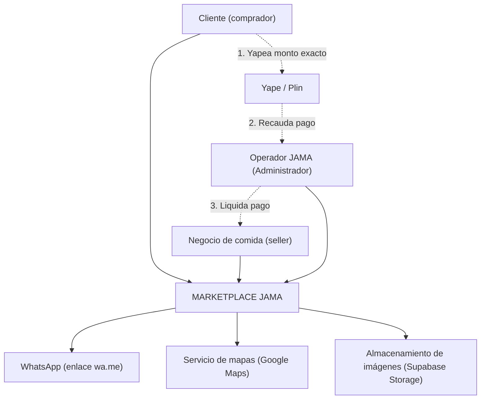

# 01 · Actores

Actores: personas, organizaciones o sistemas externos que están **fuera** del sistema e interactúan con él.

## Diagrama de contexto

## Actores humanos

| Actor | Descripción | ¿Qué necesita realizar? |
|---|---|---|
| **Cliente (comprador)** | Estudiante, trabajador o vecino de Huamanga sensible al precio. Entra desde la web sin registrarse. | Ver ofertas de cierre vigentes en Zona Centro, filtrar por rubros, pedir en un toque, pagar mediante Yape centralizado a JAMA, enviar su constancia a WhatsApp de operaciones y recoger con su código en el local. |
| **Negocio de comida (seller)** | Pollería, panadería o pastelería de Huamanga que tiene excedentes aptos al cierre. | Registrarse mediante solicitud, personalizar su perfil con portada, logotipo y redes, publicar o editar ofertas del día (o enviarlas por WhatsApp para publicación asistida), validar la entrega y revisar sus métricas de impacto comercial y ecológico. |
| **Administrador (Operador JAMA)** | Equipo de operaciones de JAMA en Huamanga. | Verificar y aprobar solicitudes de comercios, publicar ofertas asistidas a nombre de locales, validar transferencias Yape de clientes, autorizar órdenes de recojo a tiendas y liquidar los fondos a los comercios aliados. |

## Sistemas externos

| Actor | Tipo de relación | ¿Qué hace? |
|---|---|---|
| **WhatsApp** | Integración por enlace (`wa.me`), sin costo de API | Facilita la comunicación: cliente envía comprobante Yape a JAMA Operaciones; JAMA notifica la autorización de recojo a la tienda; y la tienda envía datos de excedentes para publicación asistida. |
| **Servicio de mapas (Google Maps)** | Integración vía enlaces y búsqueda estructurada | Muestra la ubicación precisa del local en Huamanga y guía al cliente en su recojo a pie. |
| **Almacenamiento de imágenes (Supabase Storage)** | Integración vía SDK / API REST | Almacena y sirve con compresión las fotos de las ofertas, fotos de portada y logotipos comerciales. |
| **Yape / Plin** | Canal de pago bancario móvil | El cliente transfiere el importe del pedido al número oficial de JAMA; el equipo de operaciones concilia el abono antes de autorizar la entrega y liquida al comercio aliado. |

> **Decisión de análisis:** Para la fase inicial en Huamanga, no se contrató una pasarela de pago bancaria automática (Niubiz/Culqi) para evitar comisiones fijas prematuras. El modelo **Concierge Marketplace** centraliza el cobro con Yape y la liquidación al comercio, garantizando cero riesgo de *no-shows* para el comerciante y trazabilidad total.
