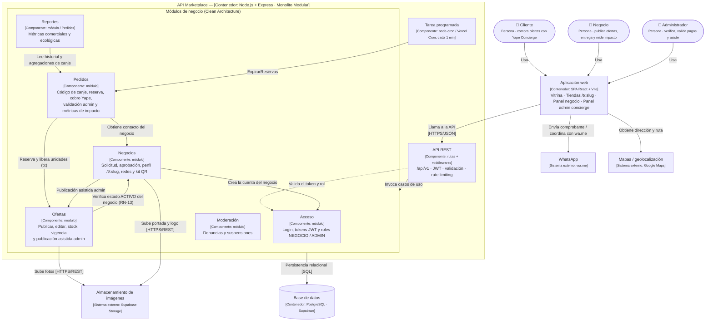

# Componentes arquitectónicos

> Estilo: Monolito modular en capas ([ADR-001](decisiones/ADR-001-monolito-modular.md)) · Enfoque interno: Clean Architecture ([ADR-002](decisiones/ADR-002-clean-architecture.md))

## Diagrama de componentes

**Notas:**
- Cada componente es un módulo del monolito: todos se despliegan juntos.
- Un módulo usa a otro **solo a través de su API pública** (`index.js`), nunca leyendo sus tablas directamente.
- Pedidos y Ofertas comparten la transacción (`tx`) al reservar stock: `SELECT ... FOR UPDATE` en PostgreSQL ([ADR-003](decisiones/ADR-003-postgresql-transacciones.md)).
- El backend construye enlaces oficiales estructurados `wa.me`, y el navegador del cliente o del administrador los ejecuta ([ADR-007](decisiones/ADR-007-integraciones-puertos-adaptadores.md)).
- En el modelo Concierge ([ADR-013](decisiones/ADR-013-flujo-concierge-cobro-yape-y-publicacion-asistida.md)), el cliente Yapea a JAMA y el administrador valida en `/admin` y liquida al comercio.

## Responsabilidad de cada componente

| Componente | Responsabilidad | Casos de uso principales | Carpeta en el código |
|---|---|---|---|
| **API REST** | Punto de entrada HTTP: rutas `/api/v1`, autenticación, validación, límite de peticiones y manejo de errores | Middlewares de Auth, RateLimit y ErrorHandler | `src/api/` |
| **Acceso** | Identidad y roles (`NEGOCIO`, `ADMIN`); el cliente es anónimo | `Login`, `LoginAdmin` | `src/modulos/acceso/` |
| **Negocios** | Solicitudes de registro, ciclo PENDIENTE → ACTIVO/RECHAZADO, perfil público `/t/:slug`, redes y kit QR de mostrador | `RegistrarSolicitud`, `ResolverSolicitud`, `ObtenerPerfilPublico`, `ActualizarPerfil`, `SubirFotoNegocio` | `src/modulos/negocios/` |
| **Ofertas** | Publicar, editar en vivo, pausar, listar ofertas vigentes y publicación asistida desde `/admin` | `PublicarOferta`, `EditarOferta`, `ListarOfertasVigentes`, `SubirFotoOferta` | `src/modulos/ofertas/` |
| **Pedidos** | Código de canje, reserva de stock, cobro Concierge Yape, validación admin (`esAdmin: true`), expiración y métricas de impacto comercial y ecológico | `PedirOferta`, `ResolverPedido`, `ExpirarReservas`, `ObtenerMetricasNegocio` | `src/modulos/pedidos/` |
| **Tarea programada** | Disparar la expiración automática cada minuto | `ExpirarReservas` | `src/jobs/` y `/cron/` |

## Trazabilidad: ¿de qué requisito sale cada componente?

| Componente | Historias de usuario | Requisitos funcionales | Drivers | Decisiones (ADR) |
|---|---|---|---|---|
| **Aplicación web** | HU01–HU05, HU14–HU23 | RF01–RF04, RF06, RF18, RF24–RF26 | DA05, DA08 | ADR-009, ADR-012, ADR-013 |
| **API REST** | Todas | RF17 | DA04, DA08 | ADR-001, ADR-006 |
| **Acceso** | HU06, HU11, HU17 | RF17 | DA04 | ADR-006, ADR-011 |
| **Negocios** | HU06, HU14–HU18, HU20 | RF07, RF15, RF18–RF24 | DA04, DA07 | ADR-010, ADR-011, ADR-012 |
| **Ofertas** | HU01–HU03, HU07, HU08, HU23 | RF01–RF03, RF08–RF10, RF26 | DA03, DA05, DA07 | ADR-005, ADR-008, ADR-013 |
| **Pedidos** | HU04, HU09, HU10, HU21, HU22 | RF04–RF06, RF11, RF12, RF25 | **DA01, DA02**, DA03, DA06 | **ADR-003, ADR-004**, ADR-005, ADR-007, ADR-013 |
| **Tarea programada** | HU07, HU09 (indirectas) | RF05, RF10 | DA03 | ADR-005 |
| **PostgreSQL** | — | RF05, RF11, RF19 | DA02, DA08 | ADR-003 |
| **Supabase Storage** | HU03, HU07, HU18 | RF03, RF07, RF08, RF24 | DA05, DA06 | ADR-007, ADR-012 |
| **WhatsApp (enlace)** | HU04, HU17, HU22 | RF06, RF22, RF25 | DA06 | ADR-007, ADR-013 |
