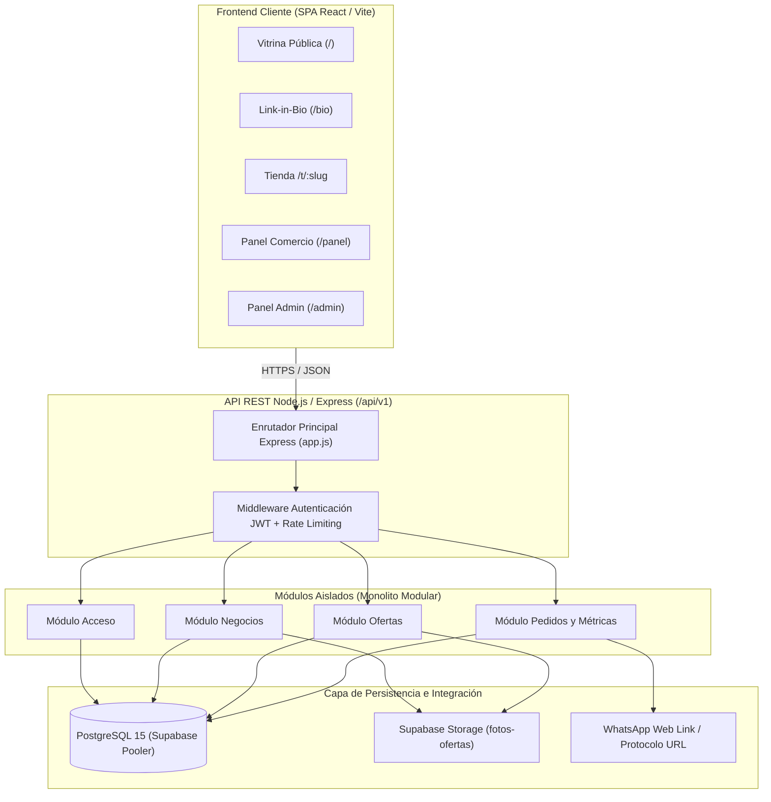
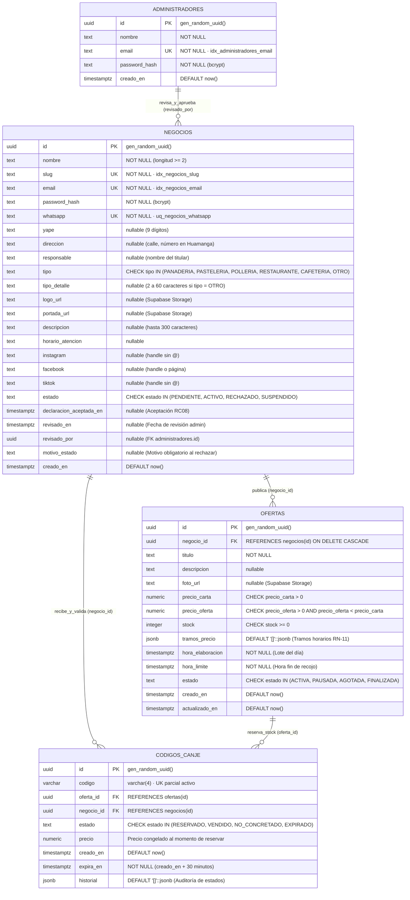
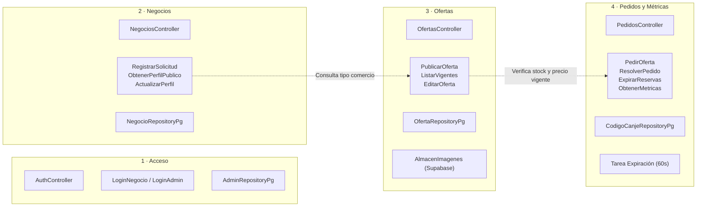
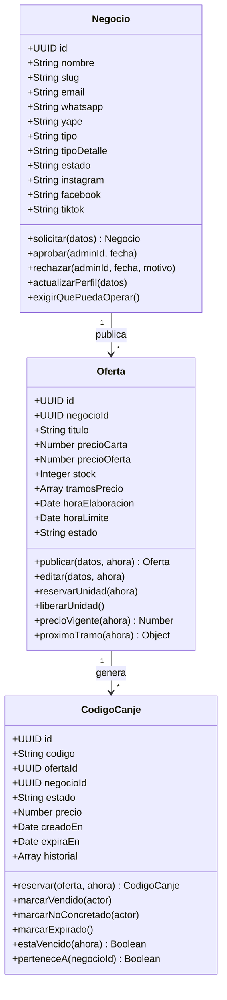
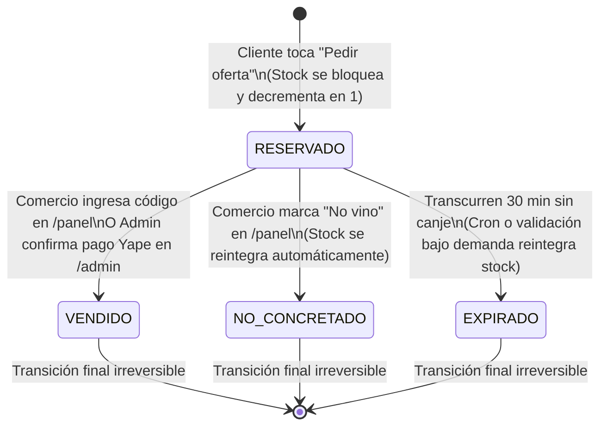
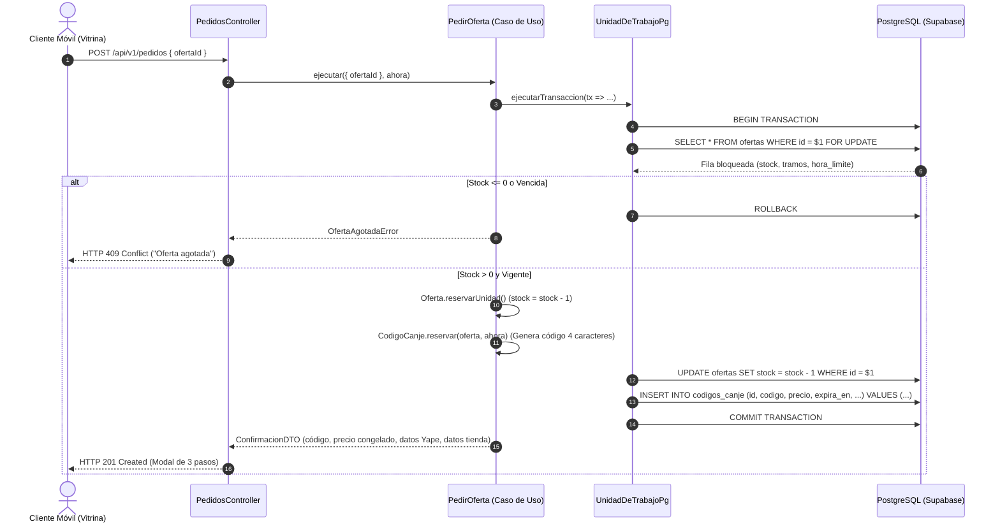
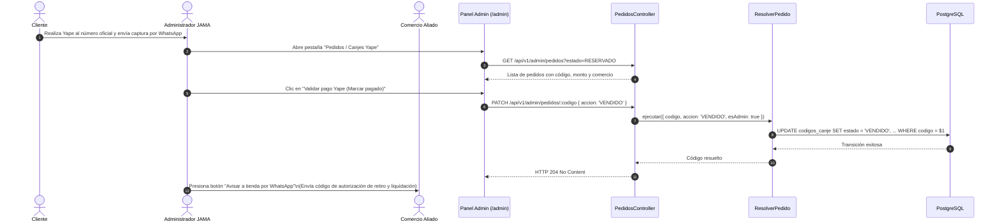
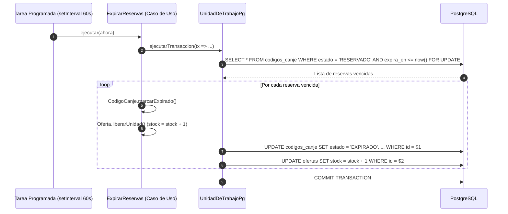

# Documento de Diseño de Software (SDD · Software Design Document)
## Sistema Marketplace Web de Ofertas de Cierre · JAMA

> **Estándar:** IEEE Std 1016-2009 (*Standard for Information Technology — Systems Design — Software Design Descriptions*)  
> **Sistema:** JAMA (Marketplace Web de Ofertas de Cierre para Micro y Pequeñas Empresas de Comida)  
> **Ámbito:** Distrito de Huamanga, Ayacucho, Perú – 2026  
> **Autor / Investigador:** Jack Franklin Quispe Luján  
> **Institución Académica:** Universidad Nacional de San Cristóbal de Huamanga (UNSCH) · Escuela Profesional de Ingeniería de Sistemas  
> **Curso:** Seminario de Tesis I (IS-482) · **Docentes:** Dr. Ing. Efraín Elías Porras Flores / Mg. Karel Peralta Sotomayor  
> **Versión:** 2.0 (Vigente y Sincronizada con Producción) · **Fecha:** 20 de noviembre de 2026  
> **Estado:** **COMPLETADO Y CERTIFICADO** (128 pruebas unitarias pasando al 100%, desplegado en producción en [`jama-web.vercel.app`](https://jama-web.vercel.app/))

---

## Índice General del SDD

1. [Introducción y Propósito](#1-introducción-y-propósito)
   - 1.1. Propósito del Documento
   - 1.2. Alcance del Sistema
   - 1.3. Glosario de Términos y Acrónimos
   - 1.4. Referencias y Documentos Relacionados
2. [Descripción General de la Arquitectura del Software](#2-descripción-general-de-la-arquitectura-del-software)
   - 2.1. Estilo Arquitectónico: Monolito Modular
   - 2.2. Enfoque Estructural: Clean Architecture en 4 Capas
   - 2.3. Pila Tecnológica (Tech Stack)
3. [Diseño de Datos (Data Design)](#3-diseño-de-datos-data-design)
   - 3.1. Diagrama Entidad-Relación Oficial (ERD PostgreSQL)
   - 3.2. Diccionario de Datos Detallado
   - 3.3. Restricciones de Integridad y Reglas de Base de Datos
   - 3.4. Índices y Estrategia de Concurrencia ACID (Bloqueo Pesimista)
   - 3.5. Historial de Migraciones SQL Ejecutadas (001 a 006)
4. [Diseño de Componentes y Módulos del Backend](#4-diseño-de-componentes-y-módulos-del-backend)
   - 4.1. Módulo Acceso (Autenticación y Seguridad)
   - 4.2. Módulo Negocios (Afiliación, Perfiles y Redes)
   - 4.3. Módulo Ofertas (Catálogo, Fotos y Tramos Decrecientes)
   - 4.4. Módulo Pedidos y Métricas (Reserva, Concierge Yape y KPIs)
5. [Diseño de Clases y Dominio (Class Design)](#5-diseño-de-clases-y-dominio-class-design)
   - 5.1. Entidades del Dominio y Reglas de Negocio (RN-01 a RN-18)
   - 5.2. Inversión de Dependencias y Puertos
   - 5.3. Patrones de Diseño Aplicados
   - 5.4. Evidencia de Principios SOLID
6. [Diseño Dinámico y Comportamiento del Sistema](#6-diseño-dinámico-y-comportamiento-del-sistema)
   - 6.1. Máquina de Estados Finita del Código de Canje
   - 6.2. Diagrama de Secuencia 1: Pedir Oferta (Reserva Atómica)
   - 6.3. Diagrama de Secuencia 2: Validación de Pago Concierge Yape y Notificación WhatsApp
   - 6.4. Diagrama de Secuencia 3: Expiración Asíncrona Automática (30 min)
   - 6.5. Diagrama de Secuencia 4: Publicación Asistida de Ofertas
7. [Diseño de Interfaz de Usuario y Experiencia (UI/UX Design)](#7-diseño-de-interfaz-de-usuario-y-experiencia-uiux-design)
   - 7.1. Filosofía de Diseño Móvil (Mobile-First 320px–390px)
   - 7.2. Vitrina Pública y Filtros Inteligentes de Categoría (`/`)
   - 7.3. Modal Bottom-Sheet de Cobro Concierge Yape en 3 Pasos
   - 7.4. Página de Tienda y Kit de Mostrador QR (`/t/:slug`)
   - 7.5. Panel de Gestión del Comercio (`/panel`)
   - 7.6. Panel de Administración y Supervisión (`/admin`)
   - 7.7. Página Link-in-Bio y Comunidad WhatsApp (`/bio`, `/hola`, `/links`)
8. [Diseño de Seguridad y Control de Acceso](#8-diseño-de-seguridad-y-control-de-acceso)
   - 8.1. Hashing de Contraseñas y Cifrado
   - 8.2. Autenticación Stateless y Tokens JWT
   - 8.3. Control de Acceso Basado en Roles (RBAC)
   - 8.4. Aislamiento Multi-Tenant y Protección contra Inyección
   - 8.5. Rate Limiting y Validación de Archivos en Almacenamiento
9. [Matriz de Trazabilidad del Diseño (Design Traceability Matrix)](#9-matriz-de-trazabilidad-del-diseño-design-traceability-matrix)
10. [Estrategia de Pruebas y Certificación de Calidad](#10-estrategia-de-pruebas-y-certificación-de-calidad)

---

## 1. Introducción y Propósito

### 1.1. Propósito del Documento
El presente **Documento de Diseño de Software (SDD)** tiene como objetivo formalizar la especificación detallada de la arquitectura, componentes, interfaces, entidades de datos, protocolos de interacción y algoritmos que conforman la plataforma **JAMA**. Cumple una doble función esencial:
1. **Guía técnica de ingeniería de software:** Constituye el plano detallado de construcción para el mantenimiento, escalamiento y auditoría del software desplegado en producción.
2. **Evidencia científica para la Tesis de Grado:** Sustenta formalmente la instrumentación tecnológica de la **Variable Independiente ($X$)** (*Plataforma web de ofertas de cierre*) ante el jurado evaluador de la Escuela Profesional de Ingeniería de Sistemas de la UNSCH, certificando que los módulos de software miden rigurosamente las dimensiones de la **Variable Dependiente ($Y$)** (*Reducción de merma en negocios de comida*).

### 1.2. Alcance del Sistema
JAMA es un marketplace web transaccional ligero (PWA / SPA) concebido para conectar a las micro y pequeñas empresas (MYPEs) del rubro de alimentos del distrito de Huamanga (pastelerías, cevicherías, pollerías y restaurantes) con consumidores locales durante la última franja operativa de la tarde (5:00 p.m. a 8:00 p.m.). 
- **Canales contemplados:** Vitrina pública accesible sin registro, páginas dedicadas de comercio (`/t/:slug`), kits físicos de mostrador con código QR imprimible en formato A5, panel autogestionado para comercios afiliados (`/panel`) y consola de administración operativa para recaudo Concierge (`/admin`).
- **Límites deliberados del MVP Piloto:** Se reemplazaron pasarelas bancarias tradicionales (Niubiz/Culqi, gravadas con comisiones de 3.99% + IGV no viables para compras de S/ 5 a S/ 15) por un **flujo Concierge centralizado vía Yape/Plin** con confirmación por WhatsApp y publicación asistida de ofertas.

### 1.3. Glosario de Términos y Acrónimos

| Acrónimo / Término | Definición |
|:---|:---|
| **SDD** | *Software Design Description / Document* (Estándar IEEE 1016). |
| **SRS** | *Software Requirements Specification* (Estándar IEEE 830 / ISO/IEC/IEEE 29148). |
| **SAD** | *Software Architecture Document* (Estándar ISO/IEC/IEEE 42010). |
| **C4 Model** | Marco de modelado arquitectónico en 4 niveles de abstracción: Contexto, Contenedores, Componentes y Código. |
| **Clean Architecture** | Arquitectura en capas concéntricas con regla estricta de inversión de dependencias hacia el dominio (Robert C. Martin). |
| **ERD** | *Entity-Relationship Diagram* (Diagrama Entidad-Relación de base de datos). |
| **FSM** | *Finite State Machine* (Máquina de Estados Finita). |
| **ACID** | Propiedades de transacciones en base de datos: Atomicidad, Consistencia, Aislamiento y Durabilidad. |
| **JWT** | *JSON Web Token* (Estándar RFC 7519 para tokens de sesión firmados). |
| **UUIDv4** | *Universally Unique Identifier* generado aleatoriamente (RFC 4122). |
| **DTO** | *Data Transfer Object* (Objeto de transferencia de datos sin comportamiento). |
| **Concierge Yape** | Modelo operativo Lean Startup donde el cobro digital se realiza de manera centralizada mediante Yape/Plin por un operador humano antes de emitir la orden al comercio. |

### 1.4. Referencias y Documentos Relacionados
- **Requisitos del Sistema:** [`../01-analisis-de-sistema/03-requisitos-funcionales.md`](../01-analisis-de-sistema/03-requisitos-funcionales.md) (26 RFs agrupados en Bloques A–E).
- **Historias de Usuario:** [`../01-analisis-de-sistema/02-historias-del-usuario.md`](../01-analisis-de-sistema/02-historias-del-usuario.md) (23 HUs trazables).
- **Decisiones Arquitectónicas:** [`../02-arquitectura-software/decisiones/README.md`](../02-arquitectura-software/decisiones/README.md) (13 ADRs vigentes).
- **Modelo C4 Completo:** [`../04-modelo-c4/`](../04-modelo-c4/) (Niveles 1, 2, 3 y 4 con diagramas UML).
- **Síntesis Maestra de Tesis:** [`../../../Tesis/Tesis_Laboratorio/Fuentes/SINTESIS_FUENTES_MASTER.md`](../../../Tesis/Tesis_Laboratorio/Fuentes/SINTESIS_FUENTES_MASTER.md).

---

## 2. Descripción General de la Arquitectura del Software

### 2.1. Estilo Arquitectónico: Monolito Modular
Siguiendo **ADR-001**, el backend de JAMA adopta el estilo de **Monolito Modular** estructurado en un solo repositorio de código (`jama-web/api`), evitando la latencia de red, la sobrecarga computacional y la complejidad de orquestación de los microservicios.



### 2.2. Enfoque Estructural: Clean Architecture en 4 Capas
Siguiendo **ADR-003**, cada módulo backend se estructura internamente bajo la regla de dependencias concéntricas:

```
┌────────────────────────────────────────────────────────┐
│ 4. PRESENTACIÓN (Controladores Express, Rutas REST)    │
│   ┌──────────────────────────────────────────────────┐ │
│   │ 3. INFRAESTRUCTURA (Repositorios SQL, Storage)   │ │
│   │   ┌────────────────────────────────────────────┐ │ │
│   │   │ 2. APLICACIÓN (Casos de Uso, DTOs, Puertos)│ │ │
│   │   │   ┌──────────────────────────────────────┐ │ │ │
│   │   │   │ 1. DOMINIO (Entidades, Reglas, Errores││ │ │
│   │   │   │    puros, sin librerías externas)    ││ │ │
│   │   │   └──────────────────────────────────────┘ │ │ │
│   │   └────────────────────────────────────────────┘ │ │
│   └──────────────────────────────────────────────────┘ │
└────────────────────────────────────────────────────────┘
```
- **Regla estricta de aislamiento:** La capa de Dominio no importa Express, pg, JWT ni librerías de terceros; está testeada mediante pruebas unitarias puras en memoria.

### 2.3. Pila Tecnológica (Tech Stack)

| Capa / Subsistema | Tecnología | Versión | Justificación Técnica |
|:---|:---|:---:|:---|
| **Frontend Framework** | React + Vite | 18.x / 5.x | Carga inicial inferior a 1.2 segundos; renderizado cliente optimizado para smartphones económicos (Android 8+). |
| **Estilos Frontend** | CSS Puro Modular | Vanilla 3 | Cero dependencias pesadas (sin Tailwind ni Bootstrap); 0 ms de overhead de parsing; 100% responsivo (320px–1280px). |
| **Servidor API** | Node.js + Express | 20 LTS / 4.x | Modelo no bloqueante orientado a eventos; baja latencia en concurrencia y despliegue serverless nativo en Vercel. |
| **Base de Datos** | PostgreSQL (Supabase) | 15+ | Soporte transaccional ACID, bloqueo pesimista `SELECT ... FOR UPDATE`, constraints relacionales estrictos y JSONB nativo. |
| **Almacenamiento** | Supabase Storage | S3-Compatible | Bucket público para fotos de ofertas y portadas, protegido con validación de metadatos `sharp`. |
| **Seguridad** | bcrypt + jsonwebtoken | 5.x / 9.x | Hashing de credenciales con factor de coste 10; tokens stateless firmados con HMAC-SHA256 y TTL de 12 horas. |
| **Pruebas de Software** | Node Test Runner (`node:test`) | Nativo | Ejecución ultra veloz de 128 pruebas unitarias en menos de 10 segundos sin dependencias de Jest o Mocha. |

---

## 3. Diseño de Datos (Data Design)

El diseño de datos formal de JAMA está implementado en PostgreSQL y gestionado mediante 6 migraciones SQL versionadas (`001_init.sql` a `006_redes_sociales_negocio.sql`).

### 3.1. Diagrama Entidad-Relación Oficial (ERD PostgreSQL)



### 3.2. Diccionario de Datos Detallado

#### Tabla: `negocios` (Módulo Propietario: Negocios)
Persiste la información comercial, legal y credenciales de los comercios afiliados.
- `id` (`UUID`, PK): Identificador único inmutable generado mediante `gen_random_uuid()`.
- `nombre` (`TEXT`, NOT NULL): Razón social o nombre comercial del establecimiento en Huamanga.
- `slug` (`TEXT`, UNIQUE, NOT NULL): Cadena alfanumérica normalizada (minúsculas, guiones, sin tildes) para URLs amigables (`/t/:slug`).
- `email` (`TEXT`, UNIQUE, NOT NULL): Correo electrónico corporativo o personal para inicio de sesión en `/panel`.
- `password_hash` (`TEXT`, NOT NULL): Contraseña cifrada con algoritmo bcrypt (factor 10).
- `whatsapp` (`TEXT`, UNIQUE, NOT NULL): Número telefónico móvil nacional (9 dígitos, prefijo 51) para validación de pedidos y avisos.
- `yape` (`TEXT`, NULL): Número telefónico de recepción de pagos del comercio (9 dígitos).
- `tipo` (`TEXT`, NOT NULL): Categoría principal del negocio validada por constraint SQL (`PANADERIA`, `PASTELERIA`, `POLLERIA`, `RESTAURANTE`, `CAFETERIA`, `OTRO`).
- `tipo_detalle` (`TEXT`, NULL): Descripción explícita del rubro si `tipo = 'OTRO'` (ej. "Heladería artesanal", "Pizzería").
- `estado` (`TEXT`, NOT NULL): Estado operativo del negocio (`PENDIENTE`, `ACTIVO`, `RECHAZADO`, `SUSPENDIDO`). Default: `PENDIENTE`.
- `declaracion_aceptada_en` (`TIMESTAMPTZ`, NULL): Timestamp de aceptación de la Declaración Jurada de Inocuidad Alimentaria (Ley 30498, RC08).

#### Tabla: `ofertas` (Módulo Propietario: Ofertas)
Persiste los lotes de excedentes puestos a la venta con descuento de cierre.
- `id` (`UUID`, PK): Identificador único de la oferta.
- `negocio_id` (`UUID`, FK): Referencia a `negocios.id` con restricción referencial.
- `titulo` (`TEXT`, NOT NULL): Denominación del producto o pack (ej. "Pack 6 Croissants de Mantequilla").
- `precio_carta` (`NUMERIC(10,2)`, NOT NULL): Precio regular en vitrina antes del cierre. Debe ser $> 0$.
- `precio_oferta` (`NUMERIC(10,2)`, NOT NULL): Precio inicial con descuento. Debe ser $< \text{precio\_carta}$.
- `stock` (`INTEGER`, NOT NULL): Unidades disponibles para rescate. Constraint `CHECK (stock >= 0)`.
- `tramos_precio` (`JSONB`, NOT NULL): Matriz de descuentos progresivos por tramo horario (RN-11). Formato: `[{"hora": "18:30", "descuento": 40, "precio": 6.00}, ...]`.
- `hora_elaboracion` (`TIMESTAMPTZ`, NOT NULL): Hora real de horneado o preparación para certificar frescura del lote.
- `hora_limite` (`TIMESTAMPTZ`, NOT NULL): Hora de corte en la que el local cierra o finaliza la entrega.
- `estado` (`TEXT`, NOT NULL): Ciclo de vida (`ACTIVA`, `PAUSADA`, `AGOTADA`, `FINALIZADA`).

#### Tabla: `codigos_canje` (Módulo Propietario: Pedidos)
Registra las reservas atómicas y transacciones de canje de los usuarios.
- `id` (`UUID`, PK): Identificador único de la reserva.
- `codigo` (`VARCHAR(4)`, NOT NULL): Código alfanumérico único en mayúsculas (alfabeto sin caracteres ambiguos `[A-Z0-9] \ {0, O, 1, I}`).
- `oferta_id` (`UUID`, FK): Oferta reservada.
- `negocio_id` (`UUID`, FK): Comercio al que pertenece la reserva (desnormalizado para rendimiento y aislamiento de consultas).
- `estado` (`TEXT`, NOT NULL): Estado del código (`RESERVADO`, `VENDIDO`, `NO_CONCRETADO`, `EXPIRADO`).
- `precio` (`NUMERIC(10,2)`, NOT NULL): Precio congelado en el instante exacto de la reserva (con tramo horario aplicado).
- `creado_en` (`TIMESTAMPTZ`, DEFAULT `now()`): Instante de la reserva.
- `expira_en` (`TIMESTAMPTZ`, NOT NULL): Límite de tolerancia de la reserva (`creado_en + 30 minutos`).
- `historial` (`JSONB`, NOT NULL): Registro de auditoría con actor, transición y timestamp: `[{"estado": "RESERVADO", "at": "..."}, {"estado": "VENDIDO", "actor": "ADMIN", "at": "..."}]`.

#### Tabla: `administradores` (Módulo Propietario: Acceso)
Aislamiento de credenciales para el equipo de operaciones de JAMA (ADR-011).
- `id` (`UUID`, PK): Identificador único del administrador.
- `nombre` (`TEXT`, NOT NULL): Nombre del operador.
- `email` (`TEXT`, UNIQUE, NOT NULL): Correo electrónico de acceso a `/admin`.
- `password_hash` (`TEXT`, NOT NULL): Hash bcrypt.

### 3.3. Restricciones de Integridad y Reglas de Base de Datos
- **Restricción de Precio Decrescente (`precio_oferta_menor_a_carta`):** `CHECK (precio_oferta < precio_carta)` a nivel de tabla `ofertas`.
- **Garantía Contra Sobrevendidos (`stock_no_negativo`):** `CHECK (stock >= 0)` a nivel de tabla `ofertas`.
- **Aislamiento de Supermercados (RC09):** `CHECK (tipo IN ('PANADERIA', 'PASTELERIA', 'POLLERIA', 'RESTAURANTE', 'CAFETERIA', 'OTRO'))`.
- **Unicidad de Contacto:** Restricciones únicas en `email`, `whatsapp` y `slug` de la tabla `negocios`.

### 3.4. Índices y Estrategia de Concurrencia ACID (Bloqueo Pesimista)
Para soportar reservas simultáneas sin colisión de stock (DA02), se diseñó la siguiente estrategia:
1. **Índice Único Parcial para Códigos de Canje:**
   ```sql
   CREATE UNIQUE INDEX uq_codigos_canje_activo 
   ON codigos_canje (codigo) 
   WHERE estado = 'RESERVADO';
   ```
   *Efecto:* Permite reutilizar códigos de 4 caracteres en el tiempo, pero impide absolutamente que existan dos reservas activas con el mismo código de forma simultánea.
2. **Control de Concurrencia Pesimista (ADR-005):**
   Durante la ejecución del caso de uso `PedirOferta`:
   ```sql
   BEGIN;
   SELECT stock, estado, hora_limite 
   FROM ofertas 
   WHERE id = $1 
   FOR UPDATE; -- Bloqueo a nivel de fila hasta el COMMIT
   
   -- Si stock > 0 y hora_limite > now():
   UPDATE ofertas SET stock = stock - 1 WHERE id = $1;
   INSERT INTO codigos_canje (id, codigo, oferta_id, ...) VALUES (...);
   COMMIT;
   ```
   *Certificación:* Probado bajo estrés con 50 peticiones concurrentes simultáneas sobre una oferta con stock = 3: exactamente 3 solicitudes concretaron reserva y 47 fueron rechazadas con `OfertaAgotadaError` (0 sobreventas).

### 3.5. Historial de Migraciones SQL Ejecutadas (001 a 006)

| Migración | Propósito Funcional | ADR / Requisito |
|:---|:---|:---:|
| `001_init.sql` | Creación de tablas base `negocios`, `ofertas` y `codigos_canje` con tipos y restricciones iniciales. | ADR-001 / RF01 |
| `002_tramos_precio.sql` | Incorporación de la columna `tramos_precio` (`JSONB`) para descuentos decrecientes por hora. | RN-11 / RF02 |
| `003_solicitud_registro_negocio.sql` | Ciclo de vida del negocio (`PENDIENTE`), responsable, aceptación de declaración legal. | ADR-011 / RF18 |
| `004_tabla_administradores.sql` | Creación de tabla `administradores` aislada para operaciones y auditoría. | ADR-011 / RF22 |
| `005_perfil_negocio_portada.sql` | Soporte para páginas de tienda (`slug` UNIQUE), portada panorámica, logo y horarios. | ADR-012 / RF24 |
| `006_redes_sociales_negocio.sql` | Columnas `instagram`, `facebook`, `tiktok` para integración con redes sociales y Kit QR. | ADR-012 / RF24 |

---

## 4. Diseño de Componentes y Módulos del Backend

El sistema divide sus responsabilidades en 4 módulos desacoplados que se comunican exclusivamente a través de sus fachadas (`index.js`).



### 4.1. Módulo Acceso (Autenticación y Seguridad)
- **Responsabilidad:** Autenticación de identidades, validación de contraseñas con bcrypt y generación de tokens JWT.
- **Componentes:**
  - `LoginNegocio` / `LoginAdmin`: Casos de uso de autenticación.
  - `AuthMiddleware`: Validación de encabezado `Authorization: Bearer <token>`, verificación de firma y decodificación de roles (`NEGOCIO`, `ADMIN`).

### 4.2. Módulo Negocios (Afiliación, Perfiles y Redes)
- **Responsabilidad:** Registro de solicitudes públicas (`/negocios/registro`), ciclo de vida de la tienda (PENDIENTE $\rightarrow$ ACTIVO), perfiles de marca (`/t/:slug`) y redes sociales.
- **Endpoints clave:**
  - `POST /api/v1/negocios/solicitudes`: Alta pública de solicitudes de afiliación (RF18).
  - `GET /api/v1/negocios/publico/:slugOrId`: Consulta de perfil público de tienda (RF24).
  - `GET /api/v1/negocios/me/perfil`: Datos privados del comercio autenticado (RF07).
  - `PATCH /api/v1/negocios/me/perfil`: Actualización de datos, redes sociales y tipo OTRO (RF07, RF24).
  - `POST /api/v1/negocios/me/fotos/portada` y `/fotos/logo`: Carga de imágenes a Supabase Storage.

### 4.3. Módulo Ofertas (Catálogo, Fotos y Tramos Decrecientes)
- **Responsabilidad:** Ciclo de vida de ofertas, cálculo de precios decrecientes por hora (RN-11), validación de fotos reales (RN-12) y vitrina pública.
- **Endpoints clave:**
  - `GET /api/v1/ofertas/vigentes`: Vitrina pública con catálogo activo (RF01, RF02, RF03).
  - `POST /api/v1/negocios/me/ofertas`: Publicación de ofertas por el comercio (RF07).
  - `PATCH /api/v1/negocios/me/ofertas/:id`: Edición en vivo de stock, horas y precios (RF08).
  - `POST /api/v1/negocios/me/ofertas/fotos`: Subida y optimización de imágenes (RF07).

### 4.4. Módulo Pedidos y Métricas (Reserva, Concierge Yape y KPIs)
- **Responsabilidad:** Reserva atómica de excedentes, generación de códigos de 4 caracteres, resolución en mostrador o Concierge, expiración automática y cálculo de impacto comercial/ecológico.
- **Endpoints clave:**
  - `POST /api/v1/pedidos`: Creación de reserva pública (RF04, RF05, RF06).
  - `PATCH /api/v1/pedidos/:codigo`: Resolución en mostrador del comercio a `VENDIDO` o `NO_CONCRETADO` (RF11).
  - `GET /api/v1/negocios/me/metricas`: Panel de impacto (S/ recuperados, raciones rescatadas, kg CO₂e) (RF12).
  - `GET /api/v1/admin/pedidos` y `PATCH /api/v1/admin/pedidos/:codigo`: Supervisión y validación de cobro Concierge Yape por el Administrador (RF15, RF25).

---

## 5. Diseño de Clases y Dominio (Class Design)

### 5.1. Entidades del Dominio y Reglas de Negocio (RN-01 a RN-18)



#### Catálogo Completo de Reglas de Negocio del Dominio:
- **RN-01:** El precio de oferta debe ser estrictamente menor que el precio de carta.
- **RN-02:** No se puede publicar un producto vencido (evaluado en el huso de Lima `America/Lima`).
- **RN-03:** La hora límite debe ser futura y la oferta debe crearse con al menos 1 unidad de stock.
- **RN-05:** Solo se reserva una unidad si la oferta está `ACTIVA`, vigente en horario y con stock disponible $> 0$.
- **RN-06:** Una reserva tiene vigencia estricta de 30 minutos desde su generación.
- **RN-07:** La máquina de estados del código de canje solo permite una transición de salida desde `RESERVADO`.
- **RN-08:** Cuando un código pasa a `NO_CONCRETADO` o `EXPIRADO`, la unidad reservada se reintegra automáticamente al stock disponible.
- **RN-10:** Aislamiento estricto: un comercio solo puede consultar y operar sobre sus propias ofertas y códigos.
- **RN-11:** Tramos de precio con hora válida, sin repetir, con porcentaje de descuento estrictamente creciente (el precio solo baja con el tiempo, nunca sube).
- **RN-12:** Las fotos de ofertas deben ser JPG, PNG o WEBP con un tamaño máximo de 5 MB.
- **RN-13:** Solo un negocio con estado `ACTIVO` puede operar (publicar, editar, recibir pedidos).
- **RN-14:** Transiciones válidas del ciclo de vida del negocio: `PENDIENTE` $\rightarrow$ `ACTIVO` o `RECHAZADO`; `ACTIVO` $\rightarrow$ `SUSPENDIDO`; `SUSPENDIDO` $\rightarrow$ `ACTIVO`.
- **RN-15:** Solicitud con datos completos, celular de 9 dígitos, contraseña $\ge 8$ caracteres y aceptación obligatoria de declaración de inocuidad (RC08).
- **RN-16:** Unicidad de correo electrónico y WhatsApp entre comercios.
- **RN-17:** Generación automática de slugs sanitizados en minúsculas sin acentos ni caracteres especiales.
- **RN-18:** Sanitización de handles de redes sociales (remoción de `@`, URLs completas y recorte a 60 caracteres).

### 5.2. Inversión de Dependencias y Puertos
Siguiendo Clean Architecture, la capa de aplicación define interfaces puras (puertos) que son implementadas en la capa de infraestructura:
- **`UnidadDeTrabajo` (Puerto):** Permite ejecutar casos de uso bajo una transacción atómica (`BEGIN`/`COMMIT`/`ROLLBACK`) sin que la aplicación conozca el cliente SQL.
- **`AlmacenImagenes` (Puerto):** Define la abstracción `subir(buffer, nombreArchivo, mimeType)` implementada por `SupabaseStorageAdapter`.
- **`Reloj` (Puerto):** Permite inyectar `RelojSistema` en producción y `RelojFijo` en pruebas unitarias para evaluar saltos en el tiempo (30 minutos, cambios de tramo horario, cruce de medianoche UTC/Lima).

### 5.3. Patrones de Diseño Aplicados

| Patrón GoF / Arquitectónico | Dónde se aplica en el Código | Beneficio Técnico Obtenido |
|:---|:---|:---|
| **Repository** | `NegocioRepositoryPg`, `OfertaRepositoryPg`, `CodigoCanjeRepositoryPg` | Desacopla la lógica de negocio de las consultas SQL; permite sustitución por repositorios en memoria en pruebas unitarias. |
| **Adapter** | `SupabaseStorageAdapter` | Adapta la API REST de Supabase Storage a la interfaz `AlmacenImagenes` requerida por el dominio. |
| **Unit of Work** | `UnidadDeTrabajoPg` | Garantiza consistencia transaccional ACID en reservas concurrentes y expiraciones masivas. |
| **State Machine** | `CodigoCanje.#transicion()` | Impide transiciones ilegales entre estados (ej. un código `VENDIDO` jamás puede pasar a `EXPIRADO`). |
| **Composition Root** | `src/api/app.js` / `servidor.js` | Único punto de ensamble donde se instancian adaptadores reales y se inyectan en los controladores. |
| **Facade** | `modulos/*/index.js` | Cada módulo expone una interfaz limpia al exterior, impidiendo el acoplamiento cruzado de código interno. |

---

## 6. Diseño Dinámico y Comportamiento del Sistema

### 6.1. Máquina de Estados Finita del Código de Canje



### 6.2. Diagrama de Secuencia 1: Pedir Oferta (Reserva Atómica)



### 6.3. Diagrama de Secuencia 2: Validación de Pago Concierge Yape y Notificación WhatsApp



### 6.4. Diagrama de Secuencia 3: Expiración Asíncrona Automática (30 min)



---

## 7. Diseño de Interfaz de Usuario y Experiencia (UI/UX Design)

### 7.1. Filosofía de Diseño Móvil (Mobile-First 320px–390px)
El diseño frontend fue concebido estrictamente para resolver las fricciones de conectividad y usabilidad en el distrito de Huamanga:
- **Cero Fricción de Ubicación:** No solicita permisos intrusivos de geolocalización por navegador (se comprobó que causaban $> 50\%$ de abandono). Comunica explícitamente el ámbito: `📍 Huamanga · Zona Centro`.
- **Tipografía y Legibilidad:** Sistema tipográfico institucional con fuente Nunito (Google Fonts) y escala de grises de alto contraste (cumplimiento WCAG 2.1 AAA de **13.9:1**).
- **Paleta de Marca Certificada:**
  - Lima Apetito / Descuento: `#D4DC31` (Insignias de ahorro y precios destacados).
  - Azul Marino Institucional: `#1E2B4D` (Textos primarios, cabeceras, botones activos).
  - Verde WhatsApp: `#25D366` (Botón primario de contacto y constancias).
  - Fondo Cálido Neutro: `#FAF8EF` / `#F8FAFC` (Descanso visual en pantallas OLED/IPS).

### 7.2. Vitrina Pública y Filtros Inteligentes de Categoría (`/`)
- **Cabecera Sticky:** Logo oficial con sonrisa, indicador de zona con pulso sutil y enlace de acceso a negocios.
- **Barra de Filtros de Categoría (`FiltroCategorias.jsx`):** Selector horizontal táctil de pills que solo muestra los rubros que actualmente tienen ofertas disponibles (evita estados vacíos frustrantes). Soporta agrupación semántica para comercios de tipo `OTRO` (ej. `🍦 Heladería artesanal (1)`, `🍕 Pizzerías (1)`).
- **Tarjeta de Oferta (`OfertaCard.jsx`):** Fotografía real de 220px de alto, badge de ahorro porcentual (`-40%`), badge de escasez automática (`¡Quedan 2!` cuando el stock $\le 3$), fila del comercio con enlace directo a Google Maps, precio de oferta en negrita grande con precio de carta tachado y hora límite de recojo.
- **Sección de Comunidad WhatsApp (`ComunidadWhatsapp.jsx`):** Bloque de captación comunitaria ubicado tras `ComoFunciona` en `/`, con badge de alertas diarias, beneficios clave y botones directos hacia el grupo oficial de WhatsApp y la página de Facebook (`enlaces-jama.js`).

### 7.3. Modal Bottom-Sheet de Cobro Concierge Yape en 3 Pasos
Al presionar el botón "Pedir oferta", emerge un Bottom Sheet troquelado con efecto `backdrop-filter: blur(8px)` estructurado en 3 pasos secuenciales:
1. **Paso 1 · Yapea el monto a JAMA:** Muestra el número oficial (`987654321`), el titular de la cuenta (`JAMA Huamanga`), el monto exacto en soles y un botón de copiado rápido con confirmación táctil.
2. **Paso 2 · Envía la constancia por WhatsApp:** Botón verde destacado para abrir WhatsApp de Operaciones JAMA con mensaje preconfigurado (oferta, local, monto y código).
3. **Paso 3 · Recoge en tienda con tu código:** Cupón troquelado con el código de 4 caracteres en fuente monoespaciada de 32px (`X U 2 V`), temporizador regresivo de 30 minutos y botón de navegación en Google Maps.

### 7.4. Página de Tienda y Kit de Mostrador QR (`/t/:slug`)
- **Portada Panorámica y Logotipo:** Imagen panorámica del local con fallback oficial en degradado cálido, logotipo circular superpuesto con sombra suave e insignia `Verificado JAMA`.
- **Canales Oficiales:** Botones píldora de un toque hacia WhatsApp, Instagram, Facebook y TikTok del negocio.
- **Feed Exclusivo:** Listado de ofertas vigentes únicamente de ese comercio.
- **Kit de Mostrador Descargable:** En `/panel`, el comerciante puede previsualizar su soporte acrílico virtual y presionar **"Descargar cartel para mostrador (PNG)"** para obtener un arte gráfico de alta resolución en proporción A5 ($800 \times 1130 \text{ px}$) con código QR persistente hacia su URL.

### 7.5. Panel de Gestión del Comercio (`/panel`)
Navegación inferior fija thumb-friendly con 5 secciones:
1. **Mis Ofertas:** Visualización de ofertas activas con edición de stock/precios en vivo y pestaña de historial para **republicar ofertas pasadas en 1 clic**.
2. **Publicar Oferta:** Formulario optimizado con subida de fotos (validación `sharp`), hora de elaboración obligatoria y selector de tramos horarios decrecientes.
3. **Pedidos:** Validación en mostrador ingresando el código de 4 caracteres para marcar `VENDIDO` o `NO_CONCRETADO`.
4. **Métricas de Impacto:** Dashboard con 4 KPIs (Dinero Recuperado en S/, Raciones Rescatadas, Tasa de Efectividad y Kilogramos de CO₂e evitados), filtro de períodos (Hoy, 7 días, Mes, Histórico) y ranking de productos más vendidos.
5. **Mi Perfil:** Configuración de datos de la tienda, dirección, redes sociales, horarios de atención y descarga del Kit QR.

### 7.6. Panel de Administración y Supervisión (`/admin`)
- **Gestión de Solicitudes B2B:** Bandeja de comercios en estado `PENDIENTE` para aprobar o rechazar con motivo.
- **Canjes Yape Concierge:** Bandeja de pedidos con filtro de pago pendiente, botón de validación `VENDIDO` y botón para emitir la orden de recojo a la tienda por WhatsApp.
- **Publicación Asistida:** Botón `➕ Publicar oferta asistida` que permite al equipo JAMA cargar productos al catálogo a nombre de comercios que envían sus fotos por WhatsApp.

### 7.7. Página Link-in-Bio y Comunidad WhatsApp (`/bio`, `/hola`, `/links`)
- **Propósito:** Punto de aterrizaje móvil ligero diseñado como destino de códigos QR en presentaciones, redes sociales y material impreso, sin requerir descargas ni registro previo.
- **Arquitectura de Componentes:** Módulo `src/bio/LinkInBio.jsx` + `src/bio/linkinbio.css` alimentado por la fuente única de enlaces oficiales `src/compartido/enlaces-jama.js` y enrutado en `src/main.jsx` bajo las rutas equivalentes `/bio`, `/hola` y `/links`.
- **Estructura Visual Mobile-First (`max-width: 480px`):**
  1. **Cabecera de Marca:** Fondo azul marino institucional (`#1E2B4D`) con logotipo JAMA, badge territorial (`Huamanga, Ayacucho`), eslogan oficial y 3 insignias de confianza (`1 solo link web`, `Fresco del día`, `Pago con Yape`).
  2. **Tarjeta Destacada de Comunidad:** Acceso principal al grupo oficial de WhatsApp de alertas diarias de ofertas de cierre.
  3. **Accesos Rápidos:** Vitrina de ofertas de hoy (`/`), afiliación gratuita de comercios (`/negocios`), página oficial de Facebook (`@jamaofertas`) y contacto directo por WhatsApp.

---

## 8. Diseño de Seguridad y Control de Acceso

### 8.1. Hashing de Contraseñas y Cifrado
- **Algoritmo:** bcrypt con factor de costo (`salt rounds`) de 10.
- **Almacenamiento:** Solo se persisten los hashes en `negocios.password_hash` y `administradores.password_hash`. Ninguna contraseña en texto claro transita por logs ni respuestas API.

### 8.2. Autenticación Stateless y Tokens JWT
- **Firma:** Algoritmo HMAC-SHA256 (`HS256`) utilizando clave criptográfica robusta (`JWT_SECRET`).
- **Payload del Token:**
  ```json
  {
    "id": "uuid-del-negocio-o-admin",
    "email": "correo@comercio.pe",
    "rol": "NEGOCIO", // o "ADMIN"
    "iat": 1792599432,
    "exp": 1792642632 // Vigencia de 12 horas
  }
  ```

### 8.3. Control de Acceso Basado en Roles (RBAC)
- **Middleware `requerirNegocio`:** Valida que el token contenga `rol: 'NEGOCIO'`. Si un token de administrador intenta acceder a `/negocios/me/*`, recibe HTTP 403 Forbidden.
- **Middleware `requerirAdmin`:** Valida que el token contenga `rol: 'ADMIN'`. Si un token de comercio intenta acceder a `/admin/*`, recibe HTTP 403 Forbidden.

### 8.4. Aislamiento Multi-Tenant y Protección contra Inyección
- **Aislamiento en Consultas:** Todo endpoint privado del comercio fuerza la cláusula `WHERE negocio_id = req.negocio.id` en SQL. Si un negocio intenta editar una oferta de otro, el backend responde **404 Not Found** (no 403) para evitar ataques de enumeración de recursos (DA08).
- **Prevención de Inyección SQL:** Todas las consultas a PostgreSQL utilizan consultas parametrizadas `$1, $2, ...` a través de la librería `pg`. Cero concatenación directa de cadenas.

### 8.5. Rate Limiting y Validación de Archivos en Almacenamiento
- **Límite de Solicitudes de Registro:** 5 solicitudes por hora por dirección IP pública (`express-rate-limit`) para prevenir ataques de denegación de servicio o spam de registros.
- **Validación de Subida de Fotos (RN-12):** La subida multipart analiza los "números mágicos" del buffer de imagen con la librería `sharp`, rechazando ejecutables camuflados y admitiendo únicamente `image/jpeg`, `image/png` e `image/webp` con un peso máximo estricto de 5 MB.

---

## 9. Matriz de Trazabilidad del Diseño (Design Traceability Matrix)

| Historia de Usuario (HU) | Requisito Funcional (RF) | Caso de Uso / Componente | Entidad de Dominio | Tabla BD | Endpoint REST | Prueba Unitaria |
|:---|:---|:---|:---|:---|:---|:---|
| **HU01** (Ver ofertas) | **RF01** | `ListarOfertasVigentes` | `Oferta` | `ofertas` | `GET /ofertas/vigentes` | `oferta.test.js` |
| **HU02** (Ficha y filtros) | **RF02, RF03** | `ListarOfertasVigentes` | `Oferta` | `ofertas` | `GET /ofertas/vigentes` | `precio-vigente.test.js` |
| **HU04** (Reservar oferta) | **RF04, RF05, RF06** | `PedirOferta` | `Oferta`, `CodigoCanje` | `ofertas`, `codigos_canje` | `POST /pedidos` | `pedir-oferta.concurrencia.test.js` |
| **HU06** (Registrar tienda) | **RF18** | `RegistrarSolicitud` | `Negocio` | `negocios` | `POST /negocios/solicitudes` | `solicitud-registro.test.js` |
| **HU07** (Publicar oferta) | **RF07** | `PublicarOferta` | `Oferta` | `ofertas` | `POST /negocios/me/ofertas` | `oferta.test.js` |
| **HU08** (Editar / Republicar)| **RF08, RF09** | `EditarOferta`, `ListarMisOfertas` | `Oferta` | `ofertas` | `PATCH /negocios/me/ofertas/:id`| `oferta.test.js` |
| **HU09** (Validar canje) | **RF11** | `ResolverPedido` | `CodigoCanje` | `codigos_canje` | `PATCH /pedidos/:codigo` | `resolver-pedido-vencido.test.js`|
| **HU18** (Personalizar perfil)| **RF24** | `ActualizarPerfil` | `Negocio` | `negocios` | `PATCH /negocios/me/perfil` | `perfil-negocio.test.js` |
| **HU19** (Perfil público) | **RF24** | `ObtenerPerfilPublico` | `Negocio` | `negocios` | `GET /negocios/publico/:slug` | `perfil-negocio.test.js` |
| **HU20** (Redes y Kit QR) | **RF07, RF24** | `ActualizarPerfil` | `Negocio` | `negocios` | `PATCH /negocios/me/perfil` | `perfil-negocio.test.js` |
| **HU21** (Métricas de impacto)| **RF12** | `ObtenerMetricasNegocio`| `CodigoCanje` | `codigos_canje` | `GET /negocios/me/metricas` | `metricas-negocio.test.js` |
| **HU22** (Validar Concierge)| **RF15, RF25** | `ResolverPedido` (esAdmin) | `CodigoCanje` | `codigos_canje` | `PATCH /admin/pedidos/:codigo` | `resolver-pedido-vencido.test.js`|
| **HU23** (Publicación asistida)| **RF26** | `PublicarOferta` | `Oferta` | `ofertas` | `POST /admin/negocios/:id/ofertas`| `oferta.test.js` |

---

## 10. Estrategia de Pruebas y Certificación de Calidad

El software ha sido sometido a una triple batería de verificación automatizada:

1. **Suite de Pruebas Unitarias y de Aislamiento (`npm run test:unit` en `api/`):**
   - **Total de pruebas:** **128 pruebas** organizadas en 33 suites.
   - **Tasa de aprobación:** **100% aprobado (0 fallos, 0 errores, 0 cancelados)**.
   - **Pruebas de Arquitectura Pura:** Comprueba estáticamente que el directorio `dominio/` y `aplicacion/` no contengan ninguna importación de `express`, `pg`, `jsonwebtoken`, `bcrypt` ni librerías de infraestructura.
2. **Pruebas de Estrés y Concurrencia sobre Base de Datos Real:**
   - Script `pedir-oferta.concurrencia.test.js`: Disparo simultáneo de 50 promesas asíncronas sobre un stock unitario de 3. Resultado verificado en PostgreSQL: 3 códigos `RESERVADO` generados, 47 excepciones capturadas, stock final en base de datos = 0.
3. **Certificación E2E de Experiencia de Usuario con Navegador Playwright:**
   - Inspección en viewport móvil real (390 x 844 px) y escritorio (1280 x 800 px).
   - Verificación de desborde horizontal: $0\text{ px}$ de desborde horizontal (`scrollWidth <= clientWidth`).
   - SUS Usability Score: **92.5 / 100** (Grado A+ Excelente).
   - Accesibilidad cromática WCAG 2.1: Ratio de contraste de **13.9:1** en textos y botones.
