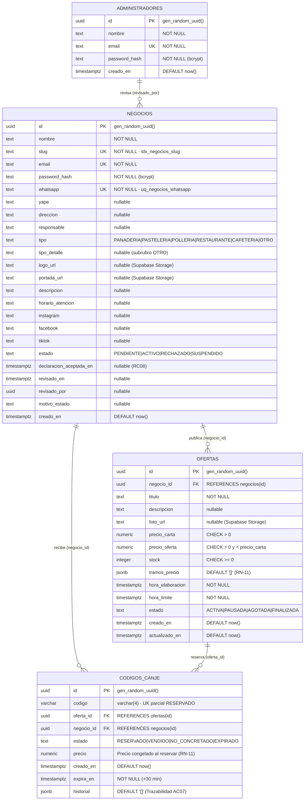

# Modelo de Datos (ERD · PostgreSQL)

> **Motor:** PostgreSQL 15+ (Supabase · Pooler Transaccional)  
> **Fuente exacta:** Migraciones SQL [`001_init.sql`](../../api/db/migrations/001_init.sql) hasta [`006_redes_sociales_negocio.sql`](../../api/db/migrations/006_redes_sociales_negocio.sql)  
> **Propósito:** Documentar las entidades físicas persistidas en base de datos, sus restricciones ACID, índices parciales y propiedad por módulo (ADR-001, ADR-003).

---

## 1. Diagrama Entidad-Relación (ERD)

---

## 2. Propiedad por Módulo y Reglas en Base de Datos

De acuerdo con el **Monolito Modular** (ADR-001), cada tabla pertenece exclusivamente a un módulo; ningún módulo consulta directamente tablas de otro módulo fuera de su fachada (`index.js`):

| Tabla | Módulo propietario | Reglas e integridad clave aplicadas en SQL |
|---|---|---|
| `negocios` | **Negocios** | • Unicidad estricta de `email`, `whatsapp` (`uq_negocios_whatsapp`) y `slug` (`idx_negocios_slug`). • Check de ciclo de vida: `PENDIENTE`, `ACTIVO`, `RECHAZADO`, `SUSPENDIDO` (RN-14). • Check de rubros permitidos excluyendo supermercados (RC09) y columna `tipo_detalle` para `OTRO` (RN-15). • Índice `idx_negocios_estado (estado, creado_en DESC)`. |
| `ofertas` | **Ofertas** | • Constraint `precio_oferta_menor_a_carta CHECK (precio_oferta < precio_carta)` (RN-01). • Constraint `CHECK (stock >= 0)` como barrera última contra sobreventa (ADR-003). • `tramos_precio` en `jsonb` para descuentos progresivos por hora (RN-11). • Índices `idx_ofertas_vigencia (estado, hora_limite)` y `idx_ofertas_negocio (negocio_id)`. |
| `codigos_canje` | **Pedidos** | • Índice único parcial `uq_codigos_canje_activo ON codigos_canje (codigo) WHERE estado = 'RESERVADO'` para impedir colisiones simultáneas. • `precio` congelado al instante de reserva (RN-11). • `historial` `jsonb` con auditoría completa de transiciones (RESERVADO → VENDIDO / NO_CONCRETADO / EXPIRADO). • Índices `idx_codigos_canje_negocio`, `idx_codigos_canje_oferta` y `idx_codigos_canje_vencidos`. |
| `administradores` | **Acceso** | • Aislamiento físico de cuentas administradoras respecto a comercios afiliados (ADR-011). |

---

## 3. Historial de Migraciones Ejecutadas

| Archivo | Propósito funcional | ADR / Etapa |
|---|---|---|
| `001_init.sql` | Esquema base: `negocios`, `ofertas`, `codigos_canje` e índices críticos. | ADR-001, ADR-003 |
| `002_panel_y_tramos_precio.sql` | Columna `tramos_precio` en `ofertas` y `precio` congelado en `codigos_canje`. | Etapa 3 (RN-11) |
| `003_alta_de_negocios.sql` | Ciclo `PENDIENTE/ACTIVO/RECHAZADO/SUSPENDIDO`, campos de solicitud y tabla `administradores`. | ADR-010, ADR-011 |
| `004_tipo_negocio_otro.sql` | Ampliación del check de rubro para soportar `OTRO` y columna `tipo_detalle`. | Etapa 15 / RN-15 |
| `005_perfil_negocio_portada.sql` | Columnas `slug`, `logo_url`, `portada_url`, `descripcion`, `horario_atencion` y migración de slugs. | ADR-012 |
| `006_redes_sociales_negocio.sql` | Columnas `instagram`, `facebook` y `tiktok` para perfil público `/t/:slug`. | Etapa 21 |
