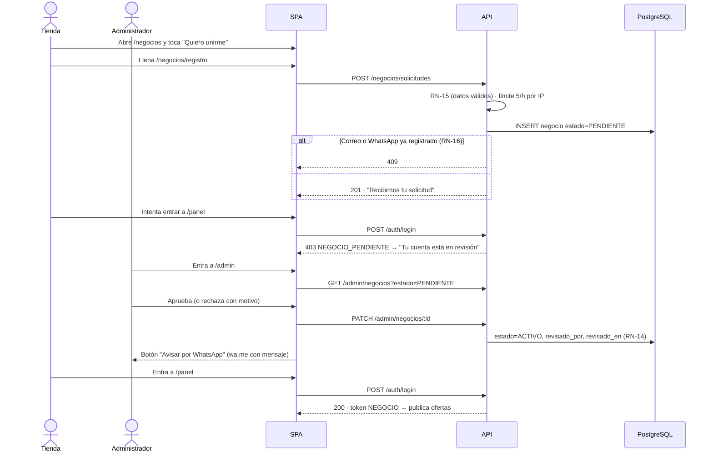

# Plan · Presentación y alta de negocios

> **Requisitos:** HU14–HU17 · RF18–RF23 (detallan RF07 y RF15) · **Reglas:** RN-13 a RN-16
> **Decisiones:** [ADR-010](../02-arquitectura-software/decisiones/ADR-010-alta-de-negocios-por-solicitud.md) (alta por solicitud con aprobación) · [ADR-011](../02-arquitectura-software/decisiones/ADR-011-cuentas-de-administrador.md) (cuentas de administrador)

---

## 1. Objetivo

Que una pastelería o panadería de Huamanga pueda **conocer JAMA, solicitar su cuenta desde el celular y empezar a publicar** cuando el equipo la apruebe, sin que aparezca en la vitrina ningún negocio sin revisar.

La landing actual (`/`) se queda para los **clientes**: les presenta JAMA y los lleva a las ofertas. Las tiendas tienen su propia página.

**Dentro del alcance:** página para negocios, formulario de solicitud, estados del negocio, bloqueo de negocios no activos, panel mínimo de administración para aprobar o rechazar.

**Fuera del alcance (se mantiene como estaba):** edición del perfil del negocio desde el panel, planes Gratis/Pro (RF13), suspensión desde el panel de administración (la regla queda lista en el dominio, el botón no), recuperación de contraseña, reportes y moderación.

---

## 2. Mapa de páginas

| Ruta | Para quién | Qué hace | Estado |
|---|---|---|---|
| `/` | Cliente | Presenta JAMA, muestra las ofertas del día, cómo funciona y preguntas. | Existe |
| `/negocios` | Tienda que no conoce JAMA | Le explica qué gana, cómo funciona de su lado y qué necesita. Botones a la solicitud y al panel. | **Nueva** |
| `/negocios/registro` | Tienda que quiere unirse | Formulario de solicitud y pantalla de "solicitud recibida". | **Nueva** |
| `/panel` | Negocio con cuenta | Login + Mis ofertas, Publicar y Pedidos. Ahora explica si la cuenta está en revisión, rechazada o suspendida, y enlaza a la solicitud. | Existe · se ajusta |
| `/admin` | Equipo de JAMA | Login de administrador y lista de solicitudes para aprobar o rechazar, con aviso por WhatsApp. | **Nueva** |

Los botones "Publicar oferta" y "¿Tienes una pastelería o panadería?" de la landing pasan a apuntar a `/negocios` (hoy llevan al login del panel, donde una tienda nueva no puede hacer nada).

Todas son rutas de la misma SPA (ADR-009). El *rewrite* a `index.html` del servicio `web` en `vercel.json` ya cubre cualquier ruta nueva.

---

## 3. Flujo completo



---

## 4. Contenido de `/negocios`

Mismo sistema visual que la landing (crema predominante, azul solo en texto, botones y una caja), *mobile-first*:

1. **Hero:** "Vende lo que te queda al cierre, en vez de perderlo." · botón "Quiero unirme" (→ `/negocios/registro`) · enlace "Ya tengo cuenta" (→ `/panel`).
2. **Por qué te conviene:** recuperas parte del costo de lo que sobra, llegas a clientes nuevos de tu zona, tú pones el precio y la cantidad, sin comisiones por ahora.
3. **Cómo funciona para tu negocio** (3 pasos): publicas desde el celular en un minuto → el cliente pide y te escribe por WhatsApp con un código → le cobras por Yape o efectivo y confirmas el código en tu panel.
4. **Qué necesitas:** WhatsApp, Yape o efectivo, fotos de tus productos, y que lo que publiques esté apto y dentro de su fecha (RC08).
5. **Preguntas de negocios:** ¿cuánto cuesta?, ¿JAMA cobra el pago?, ¿qué pasa si el cliente no viene?, ¿cuánto demora la aprobación?, ¿puedo pausar una oferta?
6. **CTA final** con el mismo botón.

## 5. Formulario de `/negocios/registro`

| Campo | Regla |
|---|---|
| Nombre del negocio | Obligatorio, 2–80 caracteres |
| Nombre del responsable | Obligatorio, 2–80 caracteres |
| Tipo de negocio | Panadería, Pastelería, Pollería, Restaurante o Cafetería (sin supermercados, RC09) |
| WhatsApp | 9 dígitos que empiezan en 9; se guarda como `51XXXXXXXXX` para el enlace `wa.me` |
| Dirección | Obligatoria (Huamanga) |
| Yape | Opcional, 9 dígitos |
| Correo | Válido; se guarda en minúsculas |
| Contraseña | Mínimo 8 caracteres |
| Declaración | Casilla obligatoria: "Solo publicaré productos aptos para el consumo y dentro de su fecha" (RC08) |

Al enviar: pantalla "Recibimos tu solicitud. Te escribiremos por WhatsApp cuando tu cuenta esté aprobada."

---

## 6. API

| Método | Ruta | Rol | Qué hace | Respuestas |
|---|---|---|---|---|
| POST | `/api/v1/negocios/solicitudes` | Público (límite 5/h por IP) | Crea el negocio en `PENDIENTE` | `201 { id, estado }` · `400` dato inválido (RN-15) · `409` correo o WhatsApp ya registrado (RN-16) · `429` |
| POST | `/api/v1/auth/login` | Público | Login de negocio (existe). Ahora valida el estado después de la contraseña | `200 { token }` · `401` credenciales · `403 { codigo: NEGOCIO_PENDIENTE \| NEGOCIO_RECHAZADO \| NEGOCIO_SUSPENDIDO, motivo? }` |
| POST | `/api/v1/auth/admin/login` | Público | Login de administrador | `200 { token }` (rol ADMIN) · `401` |
| GET | `/api/v1/admin/negocios?estado=PENDIENTE` | ADMIN | Lista negocios por estado, más recientes primero | `200 [ … ]` |
| PATCH | `/api/v1/admin/negocios/:id` | ADMIN | `{ accion: "APROBAR" }` o `{ accion: "RECHAZAR", motivo }` | `200` negocio actualizado · `400` sin motivo al rechazar · `404` · `409` transición no permitida (RN-14) |

Las rutas de negocio (`/negocios/me/*`, `/pedidos/*`) pasan a exigir **rol NEGOCIO**; las de `/admin/*`, **rol ADMIN** (ADR-011).

---

## 7. Base de datos · migración `003_alta_de_negocios.sql`

```sql
-- Estados del negocio (RN-14). Los negocios existentes siguen ACTIVO.
ALTER TABLE negocios DROP CONSTRAINT IF EXISTS negocios_estado_check;
ALTER TABLE negocios ADD CONSTRAINT negocios_estado_check
  CHECK (estado IN ('PENDIENTE', 'ACTIVO', 'RECHAZADO', 'SUSPENDIDO'));
ALTER TABLE negocios ALTER COLUMN estado SET DEFAULT 'PENDIENTE';

ALTER TABLE negocios
  ADD COLUMN IF NOT EXISTS responsable text,
  ADD COLUMN IF NOT EXISTS tipo text
    CHECK (tipo IN ('PANADERIA', 'PASTELERIA', 'POLLERIA', 'RESTAURANTE', 'CAFETERIA')),
  ADD COLUMN IF NOT EXISTS declaracion_aceptada_en timestamptz,
  ADD COLUMN IF NOT EXISTS revisado_en timestamptz,
  ADD COLUMN IF NOT EXISTS revisado_por uuid,
  ADD COLUMN IF NOT EXISTS motivo_estado text;

-- RN-16: un número de WhatsApp por negocio (el correo ya es UNIQUE).
CREATE UNIQUE INDEX IF NOT EXISTS uq_negocios_whatsapp ON negocios (whatsapp);
CREATE INDEX IF NOT EXISTS idx_negocios_estado ON negocios (estado, creado_en DESC);

-- ADR-011: administradores (módulo Acceso).
CREATE TABLE IF NOT EXISTS administradores (
  id uuid PRIMARY KEY DEFAULT gen_random_uuid(),
  nombre text NOT NULL,
  email text NOT NULL UNIQUE,
  password_hash text NOT NULL,
  creado_en timestamptz NOT NULL DEFAULT now()
);
```

`seed.js` pasa a insertar el negocio de prueba con `estado = 'ACTIVO'` explícito, porque el valor por defecto deja de ser ACTIVO.

---

## 8. Cambios por módulo

| Módulo | Capa | Cambio |
|---|---|---|
| **Negocios** | Dominio | `Negocio.solicitar(datos, ahora)` (RN-15), `aprobar`, `rechazar`, `suspender`, `reactivar` con tabla de transiciones (RN-14), `puedeOperar()` (RN-13). Error `NegocioNoHabilitadoError` con el estado y el motivo. |
| | Aplicación | `RegistrarSolicitud`, `ListarNegociosPorEstado`, `ResolverSolicitud`. `VerificarCredenciales` revisa el estado después de la contraseña. Nuevo `VerificarNegocioActivo` para otros módulos. |
| | Infraestructura | Repositorio: `crear`, `listarPorEstado`, `guardarEstado`; traduce la violación de índice único a `409`. |
| | Presentación | Rutas `POST /negocios/solicitudes` (con límite por IP) y `/admin/negocios`. |
| **Acceso** | Todas | Login de administrador con tabla `administradores`; middleware `requiereRol('NEGOCIO' \| 'ADMIN')`; script `crear-admin`. |
| **Ofertas** | Dominio / Aplicación / Infraestructura | Puerto `EstadoDeNegocios` (adaptador sobre la API pública de Negocios, sin leer la tabla `negocios`, ADR-001). `PublicarOferta` exige negocio ACTIVO; el listado público pide a Negocios los IDs de los negocios ACTIVO y filtra con `negocio_id = ANY(...)`; el detalle de una oferta de un negocio no activo responde 404. |
| **Pedidos** | Aplicación | `PedirOferta` no reserva si el negocio no está ACTIVO (la verificación ocurre en `reservarUnidad` de Ofertas, dentro de la misma transacción). |
| **API** | Presentación | Montaje de las rutas nuevas, códigos `403` con `codigo` para estados del negocio. |
| **Web** | — | Rutas `/negocios`, `/negocios/registro`, `/admin`; mensajes de estado en el login del panel; botones de la landing a `/negocios`. |

El test de arquitectura existente (dominio y aplicación sin Express, pg, jwt ni bcrypt) sigue aplicando a todo lo nuevo.

---

## 9. Fases

| Fase | Entrega | Criterio de aceptación |
|---|---|---|
| **1 · Reglas y API de solicitud** | Migración 003, dominio `Negocio` con estados, `POST /negocios/solicitudes`, login que bloquea no activos, publicar/listar/pedir solo para ACTIVO. | Pruebas de dominio (RN-13 a RN-16), de integración (solicitud → 201/409/400) y de aislamiento (negocio PENDIENTE no entra, no publica, no aparece en la vitrina). La suite completa sigue verde. |
| **2 · Páginas para negocios** | `/negocios`, `/negocios/registro`, mensajes de estado en `/panel`, botones de la landing a `/negocios`. | Una tienda completa la solicitud desde el celular (390 px y 320 px) en menos de 3 minutos; capturas sin desborde horizontal; el panel muestra "en revisión". |
| **3 · Panel de administración** | Tabla `administradores`, script `crear-admin`, login de admin, listar y resolver solicitudes, `/admin` con aviso por WhatsApp. | Un administrador aprueba y la tienda puede entrar; rechazar exige motivo; un token de negocio recibe `403` en `/admin/*` y uno de admin recibe `403` en `/negocios/me/*`. |
| **4 · Producción** | Migración aplicada en Supabase, cuenta de administrador creada, deploy en Vercel, `REPORTE.md` actualizado. | Recorrido real en `jama-iota.vercel.app`: solicitud → aprobación → login → publicar. |

Mientras no esté la fase 3, una solicitud se aprueba con:

```sql
UPDATE negocios SET estado = 'ACTIVO', revisado_en = now() WHERE email = 'correo@tienda.pe' AND estado = 'PENDIENTE';
```

---

## 10. Pruebas

| Tipo | Qué cubre |
|---|---|
| Dominio | `Negocio.solicitar` acepta datos válidos y rechaza cada campo inválido (RN-15); todas las transiciones permitidas y prohibidas (RN-14); `puedeOperar` solo en ACTIVO (RN-13). |
| Integración (PostgreSQL real) | Solicitud crea PENDIENTE; correo o WhatsApp repetido → 409 (RN-16); aprobar y rechazar guardan `revisado_por`/`revisado_en`. |
| Seguridad / aislamiento | Login de negocio PENDIENTE/RECHAZADO/SUSPENDIDO → 403 con su código, y 401 si la contraseña es incorrecta (no revela el estado); oferta de negocio no activo no aparece en `/ofertas` ni se puede pedir; separación de rutas por rol; límite de 5 solicitudes por hora. |
| Interfaz | Capturas con Playwright de `/negocios`, el formulario (con errores de validación) y `/admin` a 320, 390, 768 y 1280 px. |

---

## 11. Decisiones que necesita el equipo

Estas no bloquean la fase 1, pero sí el texto de las páginas:

1. **Precio para las tiendas.** La documentación prevé planes Gratis/Pro (RF13), pero no están implementados. La propuesta es decir "Gratis durante el piloto en Huamanga". ¿Están de acuerdo?
2. **Tipos de negocio aceptados.** Propuesta: panadería, pastelería, pollería, restaurante y cafetería. ¿Agregan o quitan alguno?
3. **Tiempo de aprobación** que se promete en la página (propuesta: "en menos de 24 horas").
4. **Quién será administrador** (correo y nombre) para crear la primera cuenta en producción.

---

## 12. Trazabilidad

| HU | RF | RN | ADR | Fase |
|---|---|---|---|---|
| HU14 Conocer JAMA como negocio | RF18 | — | ADR-009 | 2 |
| HU15 Enviar solicitud | RF19, RF23 | RN-15, RN-16 | ADR-010 | 1, 2 |
| HU16 Saber el estado de mi solicitud | RF20 | RN-13 | ADR-010 | 1, 2 |
| HU17 Aprobar o rechazar | RF15, RF17, RF21, RF22 | RN-14 | ADR-010, ADR-011 | 3 |
| HU06 Registrar negocio · HU11 Verificar negocios | RF07, RF15 | RN-13 a RN-16 | ADR-010 | 1–3 |
