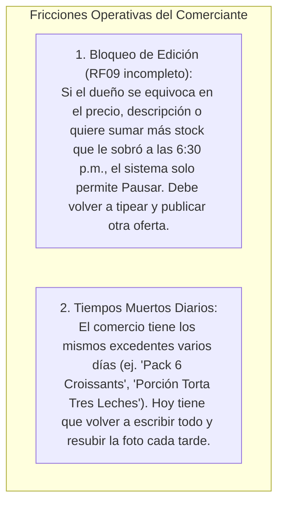
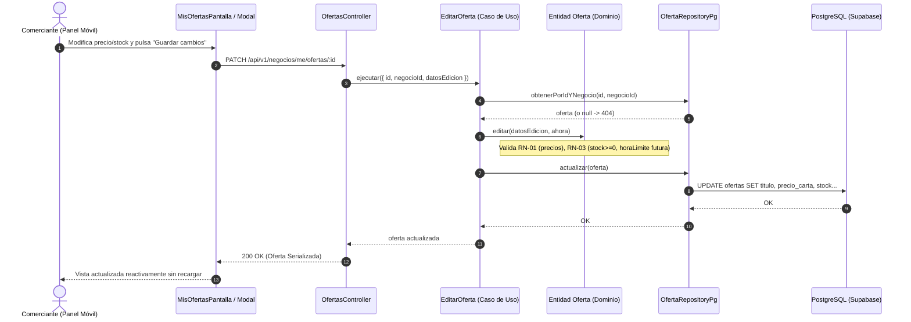

# Plan de Diseño de Software: Edición de Ofertas Activas y Republicación en 1 Toque

> **Requisitos funcionales relacionados:** [RF08 (Crear oferta)](../01-analisis-de-sistema/03-requisitos-funcionales.md), [RF09 (Gestionar ofertas: editar, pausar, finalizar)](../01-analisis-de-sistema/03-requisitos-funcionales.md), [RF10 (Finalizar ofertas)](../01-analisis-de-sistema/03-requisitos-funcionales.md)  
> **Historias de usuario:** [HU07 (Publicar oferta)](../01-analisis-de-sistema/02-historias-del-usuario.md), [HU08 (Gestionar ofertas)](../01-analisis-de-sistema/02-historias-del-usuario.md)  
> **Decisiones de arquitectura:** [ADR-001 (Monolito modular)](../02-arquitectura-software/decisiones/ADR-001-monolito-modular.md), [ADR-002 (Clean Architecture)](../02-arquitectura-software/decisiones/ADR-002-clean-architecture.md), [ADR-003 (Transacciones PostgreSQL)](../02-arquitectura-software/decisiones/ADR-003-postgresql-transacciones-y-bloqueos.md)  
> **Estado:** Implementado y verificado en producción y entorno local  
> **Fecha:** 13 de Noviembre de 2026  

---

## 1. Diagnóstico Técnico y Necesidad de Negocio

En el piloto comercial en la Zona Centro de Huamanga, los comerciantes aliados (pastelerías, panaderías, cafeterías, etc.) publican sus excedentes frescos en las tardes. Sin embargo, el flujo actual presenta dos cuellos de botella operativos:

### Objetivos del Diseño:
1. **Edición Ágil en Vivo:** Permitir modificar título, descripción, precios, stock disponible y hora límite de una oferta activa o pausada, recalculando tramos y descuentos automáticamente.
2. **Republicación en 1 Toque:** Listar ofertas anteriores del negocio y permitir prellenar el formulario de publicación con un solo clic, preservando foto, título y precios, con horario ajustado al día actual.
3. **Garantía de Integridad (Clean Architecture):** El comerciante solo puede modificar ofertas de su propia tienda (RN-10), el negocio debe estar activo (RN-13) y el precio de oferta siempre debe ser menor al de carta (RN-01).

---

## 2. Modelo de Dominio y Arquitectura

---

## 3. Especificación Técnica por Capas

### A. Capa de Dominio (`api/src/modulos/ofertas/dominio/oferta.js`)
- Método de instancia `editar(datos, ahora)`:
  - Valida que la oferta no esté `FINALIZADA`. Si está `AGOTADA` y se añade stock ($> 0$), reactiva a `ACTIVA`.
  - Valida `precioOferta < precioCarta` (RN-01).
  - Valida `stock >= 0` (RN-03).
  - Valida `horaLimite > ahora` (RN-03).
  - Si se pasan `tramosPrecio`, los revalida con `validarTramos`.
  - Actualiza `this.actualizadoEn = ahora`.

### B. Capa de Aplicación
- Nuevo caso de uso: `EditarOferta`:
  - Recibe `{ id, negocioId, titulo, descripcion, fotoUrl, precioCarta, precioOferta, stock, horaLimite, tramosPrecio }`.
  - Verifica aislamiento por negocio (`obtenerPorIdYNegocio`).
  - Llama a `oferta.editar(...)`.
  - Persiste con `ofertaRepository.actualizar(oferta)`.
- Ampliación de `ListarMisOfertas`:
  - Acepta parámetro opcional `dia`: `'hoy'` (por defecto) o `'todas'` / `'historial'`.
  - Permite recuperar ofertas anteriores para el botón de "Republicar".

### C. Capa de Infraestructura (`api/src/modulos/ofertas/infraestructura/oferta-repository-pg.js`)
- Método `actualizar(oferta, tx)`:
  - Ejecuta `UPDATE ofertas SET titulo=$1, descripcion=$2, foto_url=$3, precio_carta=$4, precio_oferta=$5, stock=$6, hora_limite=$7, estado=$8, actualizado_en=$9, tramos_precio=$10 WHERE id=$11`.

### D. Capa de Presentación (API REST)
- `PATCH /api/v1/negocios/me/ofertas/:id`:
  - Valida payload con código HTTP 400 en caso de reglas de negocio insatisfechas.
  - Responde 200 con la oferta serializada.
- `GET /api/v1/negocios/me/ofertas?filtro=todas`:
  - Devuelve historial completo del negocio.

### E. Capa Frontend (`web/src/panel`)
1. **`MisOfertasPantalla.jsx`:**
   - Botón **"Editar"** en cada oferta activa/pausada que abre un modal bottom-sheet con los campos editables precargados.
   - Pestañas o sección "Anteriores" con botón **"Republicar para hoy"**.
2. **`PanelApp.jsx` y `PublicarOfertaPantalla.jsx`:**
   - Soporte para recibir `datosIniciales` prellenados cuando se hace clic en "Republicar", permitiendo al comerciante confirmar y publicar en 1 clic.

---

## 4. Plan de Pruebas y Certificación

1. **Pruebas Unitarias de Dominio:**
   - Validación de edición con datos válidos.
   - Rechazo de precio de oferta mayor o igual al de carta (RN-01).
   - Rechazo de stock negativo.
   - Reactivación automática si se añade stock a una oferta agotada.
2. **Pruebas de Aislamiento y Seguridad:**
   - Un negocio A no puede editar la oferta de un negocio B (HTTP 404).
3. **Verificación Interactiva E2E con Subagente Browser:**
   - Editar una oferta activa en vivo y comprobar el cambio reflejado en la vitrina pública `/`.
   - Republicar una oferta pasada y verificar su publicación inmediata.
