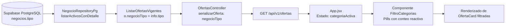

# Plan de Diseño de Software: Filtros por Categoría / Rubro en la Vitrina de Clientes

> **Requisito funcional:** [RF02 (Filtrar ofertas por categoría)](../01-analisis-de-sistema/03-requisitos-funcionales.md)  
> **Historia de usuario:** [HU02 (Filtrar ofertas por categoría)](../01-analisis-de-sistema/02-historias-del-usuario.md)  
> **Decisión arquitectónica:** [ADR-003 (Filtros en cliente para el MVP)](../02-arquitectura-software/decisiones/ADR-003-filtros-en-cliente.md)  
> **Estado:** En ejecución  
> **Fecha:** 13 de Noviembre de 2026  

---

## 1. Justificación y Propósito

Con la implementación de los **Perfiles de Negocios** ([RF07 / RF24 / ADR-012](plan-perfil-negocio-portada.md)), JAMA ahora soporta múltiples rubros comerciales en Huamanga:
- `PASTELERIA` (Pastelerías y repostería artesanal)
- `PANADERIA` (Panaderías de masa madre y pan tradicional)
- `CAFETERIA` (Cafeterías de especialidad y barra de café)
- `RESTAURANTE` (Restaurantes, menús ejecutivos y comida criolla)
- `JUGUERIA` (Juguerías, licuados y fuentes de soda)
- `OTRO` (Otros comercios de alimentos aptos)

Actualmente, la vitrina principal (`/`) lista todas las ofertas del Centro de Huamanga en un solo flujo plano sin selector de rubro. Para optimizar el tiempo de decisión del comprador (Ley de Hick), reducir la fricción de navegación y conectar la vitrina con la especialidad de cada comercio, se implementará la **barra de filtros por categoría en cliente (ADR-003)**.

---

## 2. Flujo de Datos y Arquitectura

---

## 3. Cambios en Backend (Clean Architecture)

1. **Caso de Uso `ListarOfertasVigentes`** (`api/src/modulos/ofertas/aplicacion/listar-ofertas-vigentes.caso-uso.js`):
   - Al combinar las ofertas activas con los datos del comercio (`negociosActivosDetalle`), mapear `o.negocioTipo = info.tipo ?? 'OTRO';`.
2. **Presentación `OfertasController`** (`api/src/modulos/ofertas/presentacion/ofertas.controller.js`):
   - En la función `serializarOferta(oferta, ahora)`, exponer el campo `negocioTipo: oferta.negocioTipo ?? null`.
3. **Pruebas Unitarias** (`api/tests/dominio/` y `api/tests/presentacion/`):
   - Verificar que `serializarOferta` y `ListarOfertasVigentes` incluyan `negocioTipo`.

---

## 4. Diseño del Componente Frontend (`FiltroCategorias.jsx`)

1. **Diseño Visual e Interacción (Pills Ergonómicas)**:
   - Contenedor con scroll horizontal táctil nativo (`overflow-x: auto`, `scrollbar-width: none`) para móviles de 320px–390px.
   - Cada botón pill cuenta con:
     - Icono o emoji representativo del rubro.
     - Etiqueta en español amigable.
     - Badge numérico con la cantidad de ofertas activas en esa categoría hoy (`(N)`).
   - **Pill Activa:** Fondo Azul Marino `#1E2B4D`, texto blanco, sombra suave y escala al toque (`active: scale(0.96)`).
   - **Pill Inactiva:** Fondo Crema `#FAF8EF`, borde sutil `#E2E8F0`, texto Azul Marino.
2. **Categorías Soportadas**:
   - `TODAS` ("Todas las ofertas")
   - `PASTELERIA` ("🍰 Pastelerías")
   - `PANADERIA` ("🥖 Panaderías")
   - `CAFETERIA` ("☕ Cafeterías")
   - `RESTAURANTE` ("🍲 Comida")
   - `JUGUERIA` ("🥤 Juguerías")
3. **Estado Vacío de Categoría**:
   - Si el usuario selecciona una categoría que no tiene ofertas en el momento, se muestra un mensaje amable:
     *"No hay ofertas de [Categoría] en este momento. Ver todas las ofertas de Huamanga"* con botón directo para restablecer a `TODAS`.

---

## 5. Ergonomía y Accesibilidad (WCAG 2.1)

- **Altura mínima de touch target:** 40px con `padding: 8px 14px` para pulsación cómoda con el pulgar.
- **Ratios de contraste:**
  - Activo: Blanco `#FFFFFF` sobre Azul Marino `#1E2B4D` $\rightarrow$ **13.93 : 1** (Cumple WCAG AAA).
  - Inactivo: Azul Marino `#1E2B4D` sobre Crema `#FAF8EF` $\rightarrow$ **13.09 : 1** (Cumple WCAG AAA).
- **Semántica:** Rol `tablist` o botones con `aria-pressed="true|false"` para lectores de pantalla.
