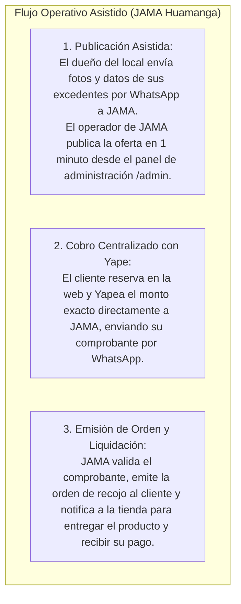
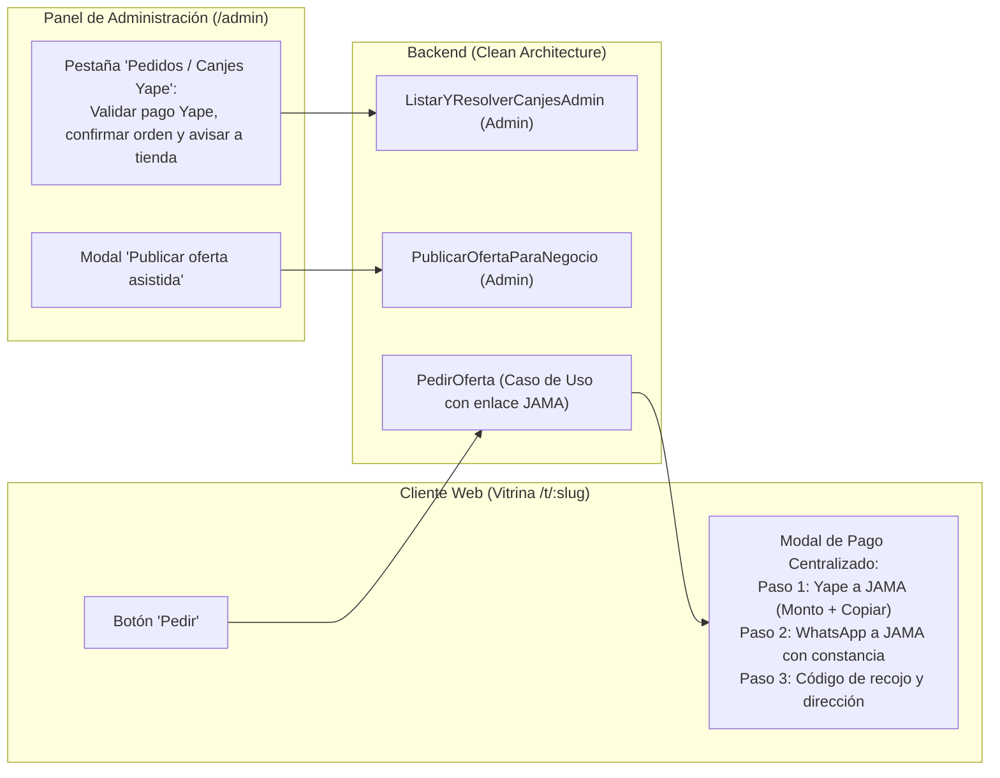

# Plan de Diseño de Software: Flujo Concierge de Cobro Centralizado con Yape y Publicación Asistida (Etapa 23)

> **Requisitos funcionales relacionados:** [RF04 (Pedir oferta / reserva)](../01-analisis-de-sistema/03-requisitos-funcionales.md), [RF06 (Confirmar canje)](../01-analisis-de-sistema/03-requisitos-funcionales.md), [RF15 (Administración de comercios)](../01-analisis-de-sistema/03-requisitos-funcionales.md), [RF18 (Seguimiento de canjes)](../01-analisis-de-sistema/03-requisitos-funcionales.md)  
> **Historias de usuario:** [HU04 (Reservar oferta)](../01-analisis-de-sistema/02-historias-del-usuario.md), [HU07 (Publicar oferta)](../01-analisis-de-sistema/02-historias-del-usuario.md), [HU09 (Validar canje)](../01-analisis-de-sistema/02-historias-del-usuario.md)  
> **Decisiones de arquitectura:** [ADR-001 (Monolito modular)](../02-arquitectura-software/decisiones/ADR-001-monolito-modular.md), [ADR-002 (Clean Architecture)](../02-arquitectura-software/decisiones/ADR-002-clean-architecture.md), [ADR-011 (Panel de Administración y avisos WhatsApp)](../02-arquitectura-software/decisiones/ADR-011-panel-de-administracion-y-avisos-whatsapp.md)  
> **Estado:** COMPLETADO Y CERTIFICADO E2E (Etapa 23)  
> **Fecha:** 13 de Noviembre de 2026  

---

## 1. Justificación y Propósito del Modelo Concierge

Para la fase de lanzamiento y consolidación en Huamanga Centro, previo a la integración de una pasarela de pago automatizada (como Niubiz, MercadoPago o Culqi), JAMA opera bajo un **modelo operativo asistido / Concierge Marketplace**:

### Ventajas Estratégicas:
1. **Cero fricción tecnológica para el comerciante:** No requiere que el dueño ingrese a diario al panel web mientras cocina u hornea; basta con enviar un mensaje de WhatsApp a JAMA.
2. **Cero riesgo de 'No-Shows' para el comercio:** El cliente ya pagó por adelantado a JAMA; el local tiene su venta garantizada.
3. **Control y confianza inicial:** Los clientes confían en la intermediación de JAMA en Huamanga mientras se valida el volumen transaccional sin pagar comisiones fijas de pasarelas bancarias.

---

## 2. Modelo de Arquitectura

---

## 3. Especificación Técnica por Capas

### A. Configuración y Parámetros Centrales
- Backend (`jama-web/api/.env`):
  - `JAMA_WHATSAPP=51987654321`: Canal central de WhatsApp de operaciones JAMA.
  - `JAMA_YAPE_NUMERO=987654321`: Línea de cobro central Yape / Plin.
  - `JAMA_YAPE_TITULAR=JAMA Huamanga`: Titular oficial de cuenta.
- Frontend (`jama-web/web/.env`):
  - `VITE_JAMA_WHATSAPP=51987654321`
  - `VITE_JAMA_YAPE_NUMERO=987654321`
  - `VITE_JAMA_YAPE_TITULAR=JAMA Huamanga`

### B. Capa de Aplicación Backend
1. **`PedirOferta` ([pedir-oferta.caso-uso.js](file:///c:/Users/jacks/Downloads/Jama%20Documentos/jama-web/api/src/modulos/pedidos/aplicacion/pedir-oferta.caso-uso.js))**:
   - Genera el código único `RESERVADO`.
   - Construye el enlace de WhatsApp dirigido a **JAMA Operaciones** con mensaje estructurado para comprobante Yape.
   - Retorna objeto `pago` (`yapeNumero`, `yapeTitular`, `monto`).
2. **`ResolverPedido` ([resolver-pedido.caso-uso.js](file:///c:/Users/jacks/Downloads/Jama%20Documentos/jama-web/api/src/modulos/pedidos/aplicacion/resolver-pedido.caso-uso.js))**:
   - Soporta bandera `esAdmin: true` para que operadores JAMA puedan validar y concretar cualquier pedido sin restricción de `negocioId`.
3. **`CodigoCanjeRepositoryPg.listarParaAdmin` ([codigo-canje-repository-pg.js](file:///c:/Users/jacks/Downloads/Jama%20Documentos/jama-web/api/src/modulos/pedidos/infraestructura/codigo-canje-repository-pg.js))**:
   - Consulta `codigos_canje` con joins a `negocios` y `ofertas`.
4. **Endpoints de Admin Concierge**:
   - `GET /api/v1/admin/pedidos`: Listado de reservas con filtro de estado.
   - `PATCH /api/v1/admin/pedidos/:codigo`: Validación de pago y cambio de estado (`VENDIDO` o `NO_CONCRETADO`).
   - `POST /api/v1/admin/negocios/:id/ofertas`: Creación asistida de ofertas activas a nombre del local.
   - `POST /api/v1/admin/negocios/:id/ofertas/fotos`: Subida de fotos para ofertas asistidas.

### C. Capa Frontend
1. **Modal de Confirmación y Pago Concierge ([PerfilTienda.jsx](file:///c:/Users/jacks/Downloads/Jama%20Documentos/jama-web/web/src/tienda/PerfilTienda.jsx) y [App.jsx](file:///c:/Users/jacks/Downloads/Jama%20Documentos/jama-web/web/src/App.jsx))**:
   - **Paso 1:** "Yapea el monto a JAMA" con número oficial, titular, monto total y botón reactivo "Copiar" (con feedback visual de check).
   - **Paso 2:** "Envía constancia a JAMA" con botón verde para abrir WhatsApp directo con JAMA.
   - **Paso 3:** "Recoge con tu código" con recuadro destacado del código (vigencia de 30 minutos), dirección física y enlace a Google Maps.
2. **Panel de Administración ([AdminPanel.jsx](file:///c:/Users/jacks/Downloads/Jama%20Documentos/jama-web/web/src/admin/AdminPanel.jsx))**:
   - Pestaña **"Pedidos / Canjes Yape"**: Lista activa con acciones "Validar pago Yape" (marca `VENDIDO`) y "Avisar a tienda por WhatsApp" (prellenado con código y autorización de entrega).
   - Pestaña **"Comercios Afiliados"**: Botón **"➕ Publicar oferta asistida"** con modal completo (título, descripción, precio normal, precio oferta, stock, hora límite y foto).

---

## 4. Evidencias de Pruebas y Certificación

1. **Pruebas Unitarias Backend:**
   - `node --test tests/dominio/**/*.test.js tests/expiracion/**/*.test.js tests/arquitectura/**/*.test.js`
   - **128 / 128 pruebas unitarias aprobadas al 100% (0 fallos)** en 9.5 segundos.
2. **Pruebas Frontend:**
   - `vite build` ejecutado exitosamente (1.10s, 0 errores).
   - `oxlint` validado con 0 errores de sintaxis y tipos.
3. **Certificación Interactiva de Extremo a Extremo en Navegador Real (390px):**
   - Modal de reserva en tienda pública con 3 pasos, botón de copiar funcional y código `CAGX`.
   - Autenticación en `/admin` con credenciales `admin@jama.pe` / `admin1234`.
   - Validación interactiva de pago Yape para pedido en pestaña "Pedidos / Canjes Yape" -> transiciona a `VENDIDO`.
   - Aprobación de nuevo comercio "Nano" en "Pendientes".
   - Publicación asistida de "1/4 Pollo a la Brasa con Papas y Cremas" (S/ 11.00) desde `/admin`.
   - Comprobación en vitrina pública (`/`) con recálculo dinámico de categorías (`🍗 Pollerías (1)`).
