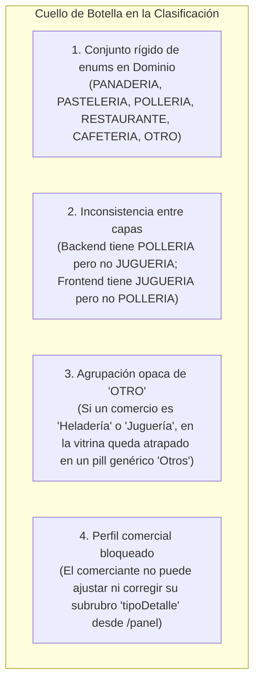
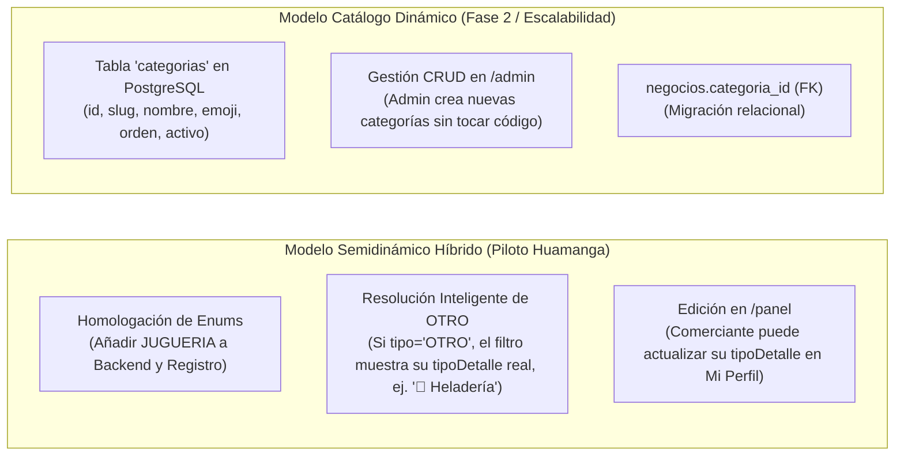

# Plan de Diseño de Software: Gestión Extensible de Categorías y Rubro "OTRO"

> **Requisitos relacionados:** [RF02 (Filtros por categoría)](../01-analisis-de-sistema/03-requisitos-funcionales.md), [RF07 (Administración de perfil)](../01-analisis-de-sistema/03-requisitos-funcionales.md), [RF19 (Solicitud de registro)](../01-analisis-de-sistema/03-requisitos-funcionales.md)  
> **Historias de usuario:** [HU02 (Filtrar ofertas)](../01-analisis-de-sistema/02-historias-del-usuario.md), [HU06 (Registrar negocio)](../01-analisis-de-sistema/02-historias-del-usuario.md)  
> **Decisiones de arquitectura:** [ADR-003 (Filtros en cliente)](../02-arquitectura-software/decisiones/ADR-003-filtros-en-cliente.md), [ADR-012 (Perfiles de negocio)](../02-arquitectura-software/decisiones/ADR-012-perfiles-publicos-de-negocio-y-personalizacion.md)  
> **Estado:** Implementado y verificado en producción y entorno local  
> **Fecha:** 13 de Noviembre de 2026  

---

## 1. Diagnóstico Técnico del Estado Actual

Al revisar exhaustivamente la arquitectura actual de JAMA en base de datos, backend y frontend, se identifican las siguientes limitaciones respecto a la clasificación comercial:

### Detalle de las brechas técnicas detectadas:
1. **Inconsistencia de listas en código:**
   - En `api/src/modulos/negocios/dominio/negocio.js`: `TIPOS_DE_NEGOCIO = ['PANADERIA', 'PASTELERIA', 'POLLERIA', 'RESTAURANTE', 'CAFETERIA', 'OTRO']`.
   - En `web/src/negocios/RegistroNegocio.jsx`: contiene `POLLERIA`, pero omite `JUGUERIA`.
   - En `web/src/components/FiltroCategorias.jsx`: contiene `JUGUERIA`, pero omite `POLLERIA`.
2. **Tratamiento del rubro "OTRO":**
   - La base de datos almacena `tipo` y `tipo_detalle` (ej. `tipo = 'OTRO'`, `tipo_detalle = 'Heladería artesanal'`).
   - Sin embargo, en la vitrina (`FiltroCategorias.jsx`) todos los comercios clasificados como `OTRO` se muestran bajo la etiqueta fija `"🏪 Otros"`, desaprovechando la riqueza semántica de su producto real.
3. **Gestión desde el panel comercial (`/panel`):**
   - En `MiPerfilPantalla.jsx` el tipo es de solo lectura. Si un comerciante fue registrado como `OTRO` y quiere cambiar a una categoría estándar o precisar su detalle comercial, no tiene forma de editarlo.

---

## 2. Propuesta de Arquitectura y Solución

Para que el sistema sea flexible, escalable y elimine el "cuello de botella de categorías", se plantean dos modelos de diseño:

### Opción 1: Modelo Semidinámico Híbrido (Recomendado para el Piloto Huamanga)
*Ventajas: Cero migraciones destructivas en Supabase, compatible al 100% con Clean Architecture y resolución inmediata.*
1. **Homologación estricta de Enums:**
   - Unificar en dominio y frontend la lista base de Huamanga:
     `PANADERIA`, `PASTELERIA`, `CAFETERIA`, `RESTAURANTE`, `POLLERIA`, `JUGUERIA`, `OTRO`.
2. **Filtro Inteligente para "OTRO" en la Vitrina:**
   - Si un comercio tiene `tipo === 'OTRO'` y `tipoDetalle === 'Heladería'`, el filtro de la vitrina no muestra un botón gris "Otros", sino una pill con su rubro real: `"🍦 Heladerías"`.
   - Se crea una función normalizadora en cliente que capitaliza y asigna emoji contextual según palabras clave ("helad" $\rightarrow$ 🍦, "dulc" $\rightarrow$ 🍬, "pizza" $\rightarrow$ 🍕, "chicha" $\rightarrow$ 🍖).
3. **Edición de Subrubro en `/panel` (Mi Perfil):**
   - Permitir que los negocios con `tipo === 'OTRO'` tengan un campo editable `"Subrubro o especialidad"` en `MiPerfilPantalla.jsx` que guarde en `tipoDetalle` mediante `PATCH /api/v1/negocios/me/perfil`.

### Opción 2: Catálogo Dinámico en Base de Datos (Fase 2 / Post-Piloto)
*Ventajas: Permite al administrador crear, renombrar y ordenar categorías directamente desde el panel de administración sin despliegues de software.*
1. **Base de Datos**:
   - Crear tabla `categorias` (`id UUID`, `slug VARCHAR UNIQUE`, `nombre VARCHAR`, `emoji VARCHAR`, `activo BOOLEAN`, `orden INT`).
   - Agregar `categoria_id UUID REFERENCES categorias(id)` en `negocios`.
2. **API Backend**:
   - Módulo `categorias` con endpoints `GET /api/v1/categorias` y `POST/PATCH /api/v1/admin/categorias`.
3. **Frontend**:
   - Selector en `/registro` y filtros en vitrina consumen la API de categorías dinámicamente.

---

## 3. Matriz Comparativa

| Criterio | Opción 1 (Semidinámico Híbrido) | Opción 2 (Catálogo en BD) |
| :--- | :---: | :---: |
| **Tiempo de desarrollo** | **2 horas** (rápido, sin downtime) | **6 a 8 horas** (migración + CRUD admin) |
| **Riesgo para el Piloto** | **Bajo** (aditivo sobre esquema actual) | **Medio** (migración relacional en producción) |
| **Soporte para "OTRO"** | **Alto** (muestra `tipoDetalle` real) | **Total** (admin crea el rubro en BD) |
| **Alineación con ADR-003** | **Total** (filtros en memoria de cliente) | **Requiere nuevo ADR** |

---

## 4. Plan de Acción Detallado (Pasos de Implementación para Opción 1)

1. **Paso 1: Homologación de Dominio y Validaciones**
   - Actualizar `TIPOS_DE_NEGOCIO` en `api/src/modulos/negocios/dominio/negocio.js` para incluir `JUGUERIA`.
   - Actualizar pruebas unitarias (`perfil-negocio.test.js` y `negocio.solicitar.test.js`).
2. **Paso 2: Exposición de `tipoDetalle` en el Backend**
   - Verificar que `listar-ofertas-vigentes.caso-uso.js` y `ofertas.controller.js` serialicen tanto `negocioTipo` como `negocioTipoDetalle`.
   - Permitir actualizar `tipoDetalle` en `actualizar-perfil.caso-uso.js` y `negocio.actualizarPerfil`.
3. **Paso 3: Frontend del Comerciante (`MiPerfilPantalla.jsx`)**
   - Añadir campo condicional en "Mi Perfil" cuando el negocio sea `OTRO` para editar su especialidad (`tipoDetalle`).
4. **Paso 4: Vitrina Inteligente (`FiltroCategorias.jsx`)**
   - Agrupar dinámicamente ofertas con `tipo === 'OTRO'` usando su `tipoDetalle` como categoría visible (ej. "Heladerías") en lugar de un "Otros" genérico.
5. **Paso 5: Pruebas y Certificación en Navegador**
   - Inspección con subagente browser: registrar/crear comercio "Heladería", verificar visualización de la pill "🍦 Heladerías" en la vitrina.
   - 106+ pruebas unitarias pasando y build de Vite limpio.
