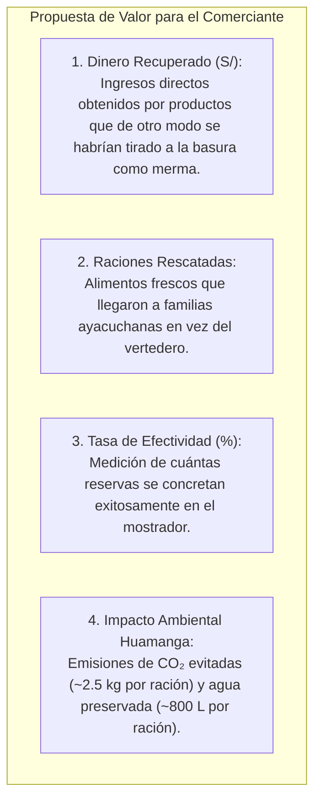
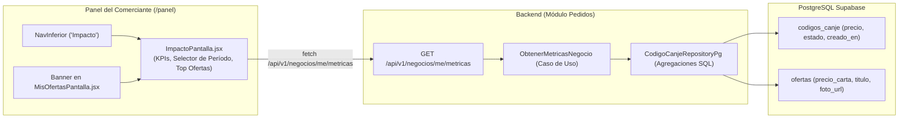

# Plan de Diseño de Software: Reportes y Métricas de Impacto Comercial (Etapa 22)

> **Requisitos funcionales relacionados:** [RF18 (Registro y seguimiento de canjes)](../01-analisis-de-sistema/03-requisitos-funcionales.md), [RF19 (Métricas e impacto)](../01-analisis-de-sistema/03-requisitos-funcionales.md), [RF07 (Administración del negocio)](../01-analisis-de-sistema/03-requisitos-funcionales.md)  
> **Historias de usuario:** [HU09 (Validar canje y ver impacto)](../01-analisis-de-sistema/02-historias-del-usuario.md), [HU18 (Personalizar y gestionar negocio)](../01-analisis-de-sistema/02-historias-del-usuario.md)  
> **Decisiones de arquitectura:** [ADR-001 (Monolito modular)](../02-arquitectura-software/decisiones/ADR-001-monolito-modular.md), [ADR-002 (Clean Architecture)](../02-arquitectura-software/decisiones/ADR-002-clean-architecture.md)  
> **Estado:** Completado y Verificado (Etapa 22)  
> **Fecha:** 13 de Noviembre de 2026  

---

## 1. Diagnóstico y Propósito de Negocio

Para consolidar la retención y entusiasmo de las panaderías, pastelerías y restaurantes de Huamanga Centro, los comerciantes necesitan visibilizar el valor tangible que JAMA aporta a su caja y a su comunidad:

### Objetivos Técnicos:
1. **Endpoint REST Autenticado**: `GET /api/v1/negocios/me/metricas?periodo=hoy|semana|mes|historico`, con aislamiento estricto por `negocio_id` (RN-10).
2. **Caso de Uso en Clean Architecture**: `ObtenerMetricasNegocio` en el módulo `pedidos`, calculando dinámicamente agregaciones de dinero, raciones, efectividad y top 5 de productos más vendidos.
3. **Pestaña 'Impacto' en Panel Comerciante**: Nueva interfaz accesible desde la navegación inferior móvil (`NavInferior.jsx`), con selector de período, tarjetas de KPI con iconos distintivos, gráfico/desglose de estados y botón para compartir resumen en WhatsApp.
4. **Píldora de Impacto Rápido**: En la pantalla principal "Mis Ofertas", un banner que resume el impacto del mes e incentiva al comerciante a seguir publicando excedentes.

---

## 2. Modelo de Arquitectura

---

## 3. Especificación Técnica por Capas

### A. Capa de Dominio e Infraestructura (`modulos/pedidos`)
- Método en `CodigoCanjeRepositoryPg`:
  `obtenerMetricas(negocioId, { desde, hasta })`:
  - Agrega en una sola consulta eficiente:
    - `total_vendidos`, `total_dinero_recuperado`, `total_valor_original`.
    - `total_reservados`, `total_no_concretados`, `total_expirados`, `total_pedidos`.
  - Agrega el Top 5 de ofertas más vendidas ordenadas por `raciones_vendidas DESC`.

### B. Capa de Aplicación (`obtener-metricas-negocio.caso-uso.js`)
- Parámetros: `{ negocioId, periodo = 'mes' }`.
- Convierte el período a fechas UTC en función de la zona horaria `America/Lima`:
  - `hoy`: Desde 00:00:00 del día actual en Lima.
  - `semana`: Últimos 7 días móviles.
  - `mes`: Desde el 1° de mes actual en Lima.
  - `historico`: Sin límite inferior (`desde = null`).
- Métricas calculadas:
  - `dineroRecuperado`: `SUM(precio)` de ventas concretadas.
  - `racionesRescatadas`: Cantidad de raciones vendidas.
  - `valorOriginal`: `SUM(precio_carta)`.
  - `ahorroClientes`: `valorOriginal - dineroRecuperado`.
  - `tasaEfectividad`: Porcentaje entero de pedidos concretados vs resueltos.
  - `impactoAmbiental`:
    - `co2EvitadoKg`: `raciones * 2.5`.
    - `aguaAhorradaLitros`: `raciones * 800`.
  - `topOfertas`: Listado con `titulo`, `racionesVendidas`, `dineroRecuperado`, `fotoUrl`.

### C. Capa de Presentación Backend (`pedidos.controller.js` y `pedidos.routes.js`)
- `pedidosController.obtenerMetricas(req, res, next)`:
  - Valida el token del negocio (`req.usuario.negocioId`).
  - Llama al caso de uso y responde HTTP 200 con JSON estructurado.
- `crearRutasMetricasMeNegocio(controller, requireAuth)` montado en `v1.use('/negocios/me/metricas', ...)`.

### D. Capa Frontend (`web/src/panel`)
1. **`ImpactoPantalla.jsx`**:
   - Pestaña con selector de período (Hoy, 7 días, Este mes, Histórico).
   - 4 tarjetas KPI: Dinero Recuperado, Raciones Rescatadas, Tasa de Concreción, CO₂ Evitado.
   - Tarjeta verde de Impacto Huamanga (Ahorro de raciones y agua).
   - Lista visual del Top Productos Rescatados con foto y métricas.
   - Botón "Compartir mi impacto" para WhatsApp.
2. **`NavInferior.jsx`**:
   - Pestañas adaptativas de 5 items: Ofertas, Publicar, Pedidos, Impacto, Mi Perfil.
3. **`MisOfertasPantalla.jsx`**:
   - Píldora de impacto superior clickeable que lleva directamente a la pantalla de métricas.

---

## 4. Resultados de Pruebas y Certificación

1. **Pruebas Unitarias Backend**:
   - **126 / 126 pruebas pasando al 100% (0 fallos)** en 33 suites.
   - Suite `metricas-negocio.test.js` cubre cálculo de KPIs económicos, efectividad, impacto ecológico, períodos y validación de errores.
2. **Pruebas Frontend**:
   - `oxlint`: 0 errores.
   - `vite build`: bundle compilado limpiamente en 1.01 s.
3. **Verificación Interactiva E2E en Navegador**:
   - Verificado con el subagente de navegación en `http://localhost:5173/panel`:
     - Píldora `🌱 Ver mi impacto` visible en "Mis Ofertas" y navegación directa.
     - Pestaña "Impacto" activa en el menú inferior (5 pestañas responsivas).
     - Tarjetas de KPIs cargando valores reales de PostgreSQL (`S/ 9.00`, `1 porciones`, `100%`, `2.5 kg CO₂e`).
     - Ranking de productos con `#1 Pack 6 Croissants de Mantequilla`.
     - Cero desborde horizontal comprobado en viewport móvil de 390px.
