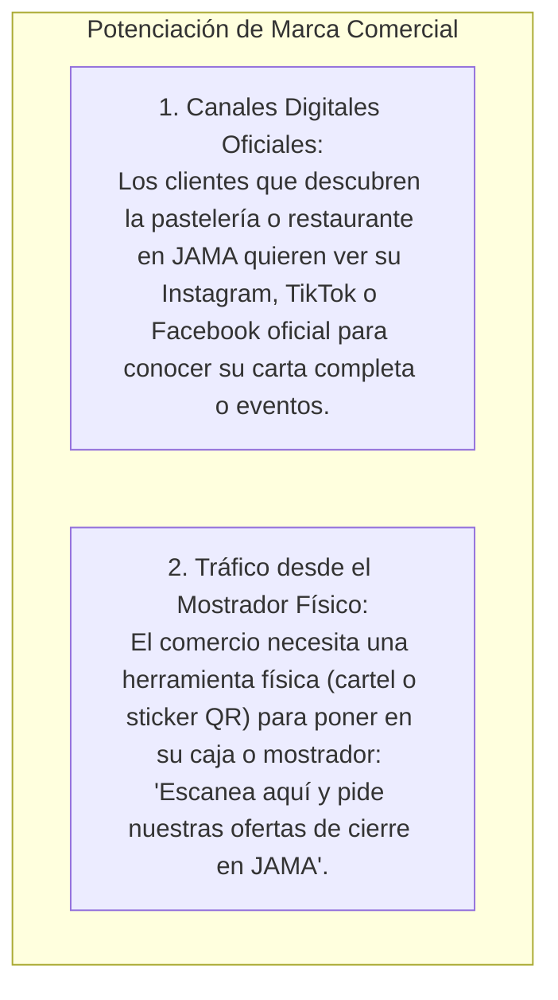
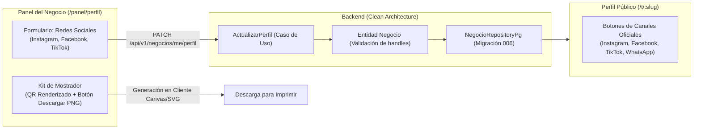

# Plan de Diseño de Software: Redes Sociales del Comercio y Kit de Mostrador QR

> **Requisitos funcionales relacionados:** [RF07 (Administración de perfil)](../01-analisis-de-sistema/03-requisitos-funcionales.md), [RF24 (Página individual de negocio)](../01-analisis-de-sistema/03-requisitos-funcionales.md)  
> **Historias de usuario:** [HU06 (Registrar negocio)](../01-analisis-de-sistema/02-historias-del-usuario.md), [HU18 (Personalizar perfil)](../01-analisis-de-sistema/02-historias-del-usuario.md), [HU19 (Ver perfil público de tienda)](../01-analisis-de-sistema/02-historias-del-usuario.md)  
> **Decisiones de arquitectura:** [ADR-002 (Clean Architecture)](../02-arquitectura-software/decisiones/ADR-002-clean-architecture.md), [ADR-012 (Perfiles de negocio)](../02-arquitectura-software/decisiones/ADR-012-perfiles-publicos-de-negocio-y-personalizacion.md)  
> **Estado:** Completado y Verificado (Etapa 21)  
> **Fecha:** 13 de Noviembre de 2026  

---

## 1. Diagnóstico Técnico y Necesidad del Piloto

Para que los comercios del Centro de Huamanga adopten JAMA con entusiasmo, la plataforma debe potenciar la visibilidad de su propia marca tanto en el plano digital como en el físico:



### Objetivos:
1. **Redes Sociales en Perfil:** Permitir a cada comercio registrar su usuario o enlace de Instagram, Facebook y TikTok, mostrándolos con insignias profesionales en su página pública `/t/:slug`.
2. **Kit de Mostrador con QR Descargable:** Generar un código QR oficial de alta resolución con el enlace `/t/:slug`, listo para descargar e imprimir en el local.
3. **Integridad Clean Architecture:** Validación y sanitización estricta de nombres de usuario en dominio (`Negocio`), persistencia en PostgreSQL y pruebas unitarias completas.

---

## 2. Modelo de Arquitectura



---

## 3. Especificación Técnica por Capas

### A. Base de Datos (Migración `006_redes_sociales_negocio.sql`)
```sql
ALTER TABLE negocios
  ADD COLUMN IF NOT EXISTS instagram text,
  ADD COLUMN IF NOT EXISTS facebook text,
  ADD COLUMN IF NOT EXISTS tiktok text;
```

### B. Capa de Dominio (`api/src/modulos/negocios/dominio/negocio.js`)
- Propiedades: `this.instagram`, `this.facebook`, `this.tiktok`.
- Sanitización en `actualizarPerfil({ ..., instagram, facebook, tiktok })`:
  - Remueve `@` inicial y prefijos de URL (`https://instagram.com/`, `https://facebook.com/`, `https://tiktok.com/@`) para estandarizar el handle.
  - Valida largo máximo (60 caracteres).

### C. Capa de Infraestructura (`negocio-repository-pg.js`)
- Mapeo de columnas `instagram`, `facebook`, `tiktok` en `filaANegocio`.
- Inclusión en `guardarPerfil` SQL `UPDATE`.

### D. Capa de Presentación Backend (`negocios.controller.js`)
- Retorno de handles y URLs completas computadas en `obtenerPerfilPublico` (`enlaceInstagram`, `enlaceFacebook`, `enlaceTiktok`) y `obtenerMiPerfil`.

### E. Capa Frontend (`web/src`)
1. **`MiPerfilPantalla.jsx`:**
   - Formulario de Redes Sociales: campos con prefijos fijos `@` y `fb.com/` para Instagram, Facebook y TikTok.
   - Tarjeta "Kit Físico de Mostrador": visualización del cartel de acrílico simulado con código QR dinámico (`qrcode`), enlaces directos y botón de generación de cartel de alta definición (800x1130 px PNG) mediante Canvas API y botón de impresión directa.
2. **`PerfilTienda.jsx`:**
   - Botones táctiles de redes sociales con iconografía oficial (Instagram, Facebook y TikTok) ubicados bajo el botón de WhatsApp.

---

## 4. Resultados de Pruebas y Certificación

1. **Pruebas Unitarias Backend:**
   - Ejecutadas con `npm run test:unit`: **122 pruebas pasando al 100% (0 fallos)** en 32 suites.
   - Incluye pruebas de sanitización y validación de redes en `Negocio` y comprobación de arquitectura limpia.
2. **Pruebas Frontend:**
   - `oxlint`: 0 errores de sintaxis y tipado.
   - `vite build`: bundle de producción generado exitosamente en 509 ms.
3. **Verificación Interactiva en Navegador:**
   - Subagente de navegador ejecutó el flujo completo en `http://localhost:5173`.
   - Modificación y guardado de redes en `/panel`:
     - Instagram: `panaderia_ejemplo`
     - Facebook: `panaderia.ejemplo.ayacucho`
     - TikTok: `panaderia_ejemplo_pe`
     - Notificación de confirmación exitosa en UI.
   - Renderizado en tienda pública `/t/panaderia-ejemplo`:
     - Botones oficiales de Instagram, Facebook y TikTok renderizados con sus enlaces canónicos externos.
   - Tarjeta Kit de Mostrador:
     - Renderizado de cartel vertical simulado con QR dinámico y descarga lista para imprenta.
