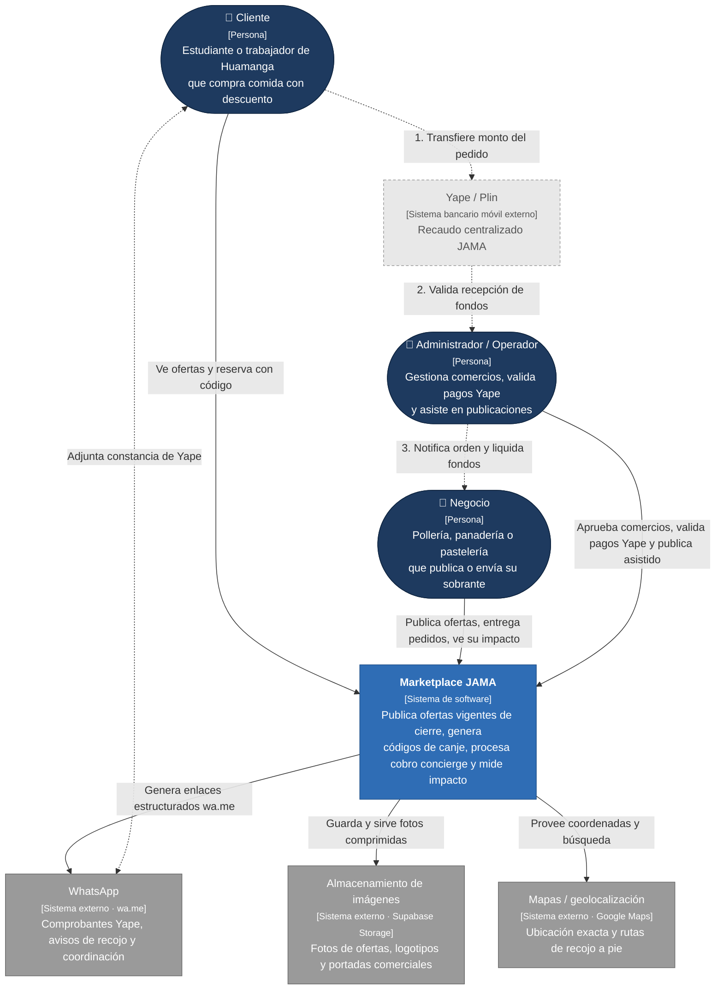

# Nivel 1 · Diagrama de contexto del sistema

> **Proyecto:** Marketplace de Ofertas de Cierre (JAMA)  
> **Modelo:** C4 · Nivel 1 de 4 · **Versión:** 1.2 (Actualizado a Flujo Concierge)  

---

## 1. Objetivo

Mostrar el **Marketplace JAMA como una sola caja**: quiénes lo usan y con qué sistemas externos se relaciona. Es la vista de mayor nivel y la primera que se presenta a cualquier persona, técnica o no.

| Aspecto | Descripción |
|---|---|
| Pregunta que responde | ¿Qué es el sistema, quién lo usa y con quién se integra? |
| Audiencia | Todos: negocios aliados, docentes de tesis, incubadora y equipo de desarrollo |
| Qué **no** muestra | Tecnologías internas, servidores, esquemas de bases de datos ni módulos |
| Siguiente nivel | [`Nivel2-DiagramadeContenedores.md`](Nivel2-DiagramadeContenedores.md) |

---

## 2. Diagrama

**Leyenda:** azul oscuro = persona · azul = sistema en alcance · gris = sistema externo · gris claro punteado = sistema financiero externo.

---

## 3. Personas (usuarios)

| Persona | Descripción | Qué hace en el sistema |
|---|---|---|
| **Cliente** | Estudiante de la UNSCH, trabajador o vecino de Huamanga; entra desde el celular | Consulta ofertas vigentes en Zona Centro, reserva con código único, paga por Yape a JAMA, envía comprobante por WhatsApp y recoge su ración en tienda. **No se registra** |
| **Negocio** | Pollería, panadería o pastelería con excedente apto al cierre | Solicita su alta, personaliza portada y redes, publica ofertas del día (o las envía por WhatsApp para publicación asistida), entrega pedidos validados y consulta métricas de impacto comercial y ecológico |
| **Administrador (Operador JAMA)** | Equipo operativo de JAMA en Huamanga | Evalúa solicitudes de negocios, valida comprobantes de Yape, transiciona pedidos a pagado, autoriza órdenes de recojo a las tiendas y publica ofertas asistidas |

---

## 4. Sistemas externos

| Sistema | Tipo | Responsabilidad | Proveedor |
|---|---|---|---|
| **Marketplace JAMA** | Sistema en alcance | Publicar ofertas, controlar stock transaccional, emitir códigos, gestionar cobro concierge y medir impacto | Equipo JAMA |
| **WhatsApp** | Sistema externo | Canal de soporte: el cliente envía comprobante Yape a JAMA, y JAMA notifica la autorización de entrega al negocio | Meta (`wa.me`) |
| **Almacenamiento de imágenes** | Sistema externo | Almacenar y optimizar fotos de productos, portadas y logotipos de comercios | Supabase Storage |
| **Mapas / geolocalización** | Sistema externo | Guiar al cliente al punto de recojo físico en Huamanga Centro | Google Maps |
| **Yape / Plin** | Sistema externo | Plataforma de pago bancario móvil donde el cliente transfiere el importe a la cuenta central de JAMA | BCP / Interbank |

---

## 5. Relaciones

| Origen | Destino | Descripción | Protocolo |
|---|---|---|---|
| Cliente | Marketplace | Consulta ofertas y genera reserva en 3 pasos | HTTPS |
| Negocio | Marketplace | Gestiona ofertas, redes, código QR y métricas | HTTPS/JWT |
| Administrador | Marketplace | Gestiona solicitudes, valida pagos y publica ofertas asistidas | HTTPS/JWT |
| Marketplace | WhatsApp | Genera enlaces estructurados con prellenado oficial | URL (`wa.me`) |
| Marketplace | Almacenamiento de imágenes | Sube y recupera fotos optimizadas | HTTPS/REST |
| Marketplace | Mapas | Abre ubicación precisa del local | URL (Google Maps) |
| Cliente ⇄ Admin ⇄ Negocio | Yape / WhatsApp | Flujo Concierge: cliente Yapea a JAMA, admin valida y liquida al negocio | Banca móvil / WhatsApp |

---

## 6. Decisiones y supuestos

| # | Decisión o supuesto | Motivo | Referencia |
|---|---|---|---|
| 1 | **Modelo Concierge de Cobro Centralizado con Yape:** JAMA recauda el monto y liquida a la tienda | Elimina pérdidas por inasistencias (*no-shows*) y comisiones de pasarelas bancarias tradicionales | RC06, ADR-013 |
| 2 | WhatsApp se usa por **enlace**, sin API de pago | Costo cero y agilidad operativa en el piloto | RC07, ADR-007 |
| 3 | Trazabilidad con **código de canje único** | Control estricto de auditoría y stock transaccional en PostgreSQL | DA01, ADR-004 |
| 4 | Recojo en mostrador en **Zona Centro de Huamanga** | Sin costos de logística de delivery durante la validación del MVP | RC12 |
| 5 | **Publicación Asistida:** Operadores pueden publicar a nombre de locales activos | Elimina la barrera tecnológica para comerciantes tradicionales ocupados en la producción | ADR-013 |
