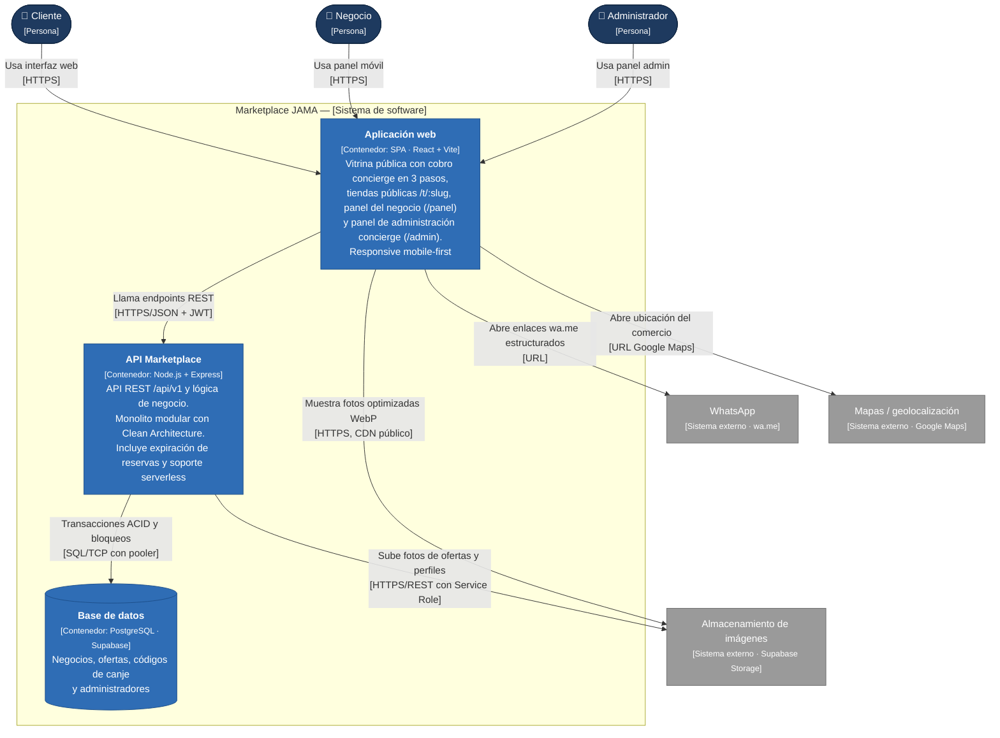

# Nivel 2 · Diagrama de contenedores

> **Proyecto:** Marketplace de Ofertas de Cierre (JAMA)  
> **Modelo:** C4 · Nivel 2 de 4 · **Versión:** 1.2 (Actualizado a Flujo Concierge y Perfiles)  

---

## 1. Objetivo

Abrir la caja «Marketplace JAMA» del nivel 1 y mostrar los **contenedores** que la forman: las aplicaciones y almacenes de datos que se ejecutan por separado, la tecnología de cada uno y cómo se comunican.

| Aspecto | Descripción |
|---|---|
| Pregunta que responde | ¿De qué piezas ejecutables se compone el sistema y con qué tecnología? |
| Audiencia | Arquitectos, desarrolladores, operaciones y evaluadores |
| Qué es un contenedor | Pieza ejecutable o de almacenamiento independiente: SPA web, API REST o base de datos |
| Nivel anterior | [`Nivel1-DiagramadeContextodelSistema.md`](Nivel1-DiagramadeContextodelSistema.md) |
| Siguiente nivel | [`Nivel3-Diagrama-de-Componentes.md`](Nivel3-Diagrama-de-Componentes.md) |

---

## 2. Diagrama

---

## 3. Contenedores

| Contenedor | Tecnología | Responsabilidad | Datos que maneja |
|---|---|---|---|
| **Aplicación web** | SPA · React 18 + Vite, *mobile-first*, Tailwind/CSS modular nativo | Vitrina de ofertas con categorías dinámicas, modal de cobro concierge con Yape en 3 pasos, tienda pública `/t/:slug` con redes y kit QR, panel del negocio (`/panel`) con métricas de impacto comercial y panel de administración (`/admin`) | Estado reactivo en memoria y tokens JWT en `localStorage` |
| **API Marketplace** | Node.js 20 + Express · **Monolito modular** con Clean Architecture | Endpoints `/api/v1`: Acceso, Negocios, Ofertas, Pedidos, tarea de expiración de reservas y manejo de concurrencia | Lógica de dominio pura; delega persistencia a PostgreSQL |
| **Base de datos** | PostgreSQL (Supabase) | Almacenamiento relacional con restricciones transaccionales, índices parciales y claves foráneas (ver [ERD](../03-diseno-de-software/modelo-datos-erd.md)) | `negocios`, `ofertas`, `codigos_canje`, `administradores` |

---

## 4. Relaciones

| Origen | Destino | Descripción | Protocolo |
|---|---|---|---|
| Cliente, Negocio, Administrador | Aplicación web | Navegación desde celulares y computadoras | HTTPS |
| Aplicación web | API Marketplace | Peticiones JSON firmadas con JWT de rol | HTTPS/REST |
| API Marketplace | Base de datos | Consultas y transacciones concurrentes con `SELECT ... FOR UPDATE` | SQL / TCP |
| API Marketplace | Almacenamiento de imágenes | Subida de archivos mediante credenciales seguras de servidor | HTTPS/REST |
| Aplicación web | Almacenamiento de imágenes | Descarga directa de fotos cacheadas | HTTPS / CDN |
| Aplicación web | WhatsApp | Generación de enlaces oficiales `wa.me` para comprobantes y avisos | URL |
| Aplicación web | Mapas | Búsqueda estructurada de direcciones en Huamanga | URL |

---

## 5. Decisiones arquitectónicas reflejadas

| Decisión | Alternativa descartada | Motivo | ADR |
|---|---|---|---|
| Monolito modular con Clean Architecture | Microservicios | Costo controlado y mantenimiento ágil por un solo desarrollador | ADR-001, ADR-002 |
| PostgreSQL transaccional | Base NoSQL / MongoDB | La reserva de raciones exige control de concurrencia estricto (cero sobreventas) | ADR-003 |
| SPA separada del backend | Renderizado SSR en servidor | Permite despliegue desacoplado en CDN y agilidad en celular | ADR-009 |
| Cuentas de administrador en tabla propia | Claim en la misma tabla de usuarios | Aislamiento físico de credenciales y seguridad auditada | ADR-011 |
| Perfiles `/t/:slug` y kit físico QR | Páginas genéricas sin marca | Empodera al comercio aliado con difusión propia en sus redes | ADR-012 |
| Flujo Concierge Yape y publicación asistida | Pasarela bancaria automatizada | Cero comisiones fijas prematuras, cobro centralizado y cero pérdidas por *no-shows* | ADR-013 |
