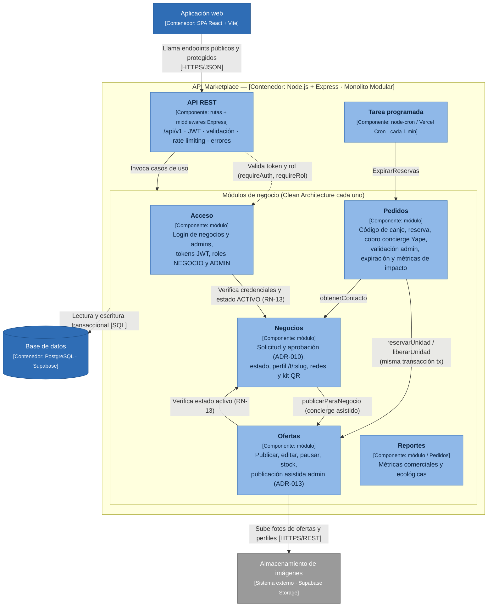

# Nivel 3 · Diagrama de componentes

> **Proyecto:** Marketplace de Ofertas de Cierre (JAMA) · **Contenedor detallado:** API Marketplace  
> **Modelo:** C4 · Nivel 3 de 4 · **Versión:** 1.2 (Actualizado a Flujo Concierge y Métricas)  

---

## 1. Objetivo

Abrir el contenedor **API Marketplace** del nivel 2 y mostrar sus **componentes**: los módulos del monolito modular, la responsabilidad de cada uno y cómo se relacionan entre sí, con la base de datos y con los sistemas externos.

| Aspecto | Descripción |
|---|---|
| Pregunta que responde | ¿Cómo se divide el backend por dentro y qué hace cada parte? |
| Audiencia | Arquitectos, evaluadores y desarrolladores |
| Qué es un componente | Grupo de funcionalidades con responsabilidad acotada y expuesta por API pública (`index.js`) |
| Nivel anterior | [`Nivel2-DiagramadeContenedores.md`](Nivel2-DiagramadeContenedores.md) |
| Siguiente nivel | [`Nivel4-DiagramadeCodigo.md`](Nivel4-DiagramadeCodigo.md) |

---

## 2. Diagrama

---

## 3. Componentes

| Componente | Responsabilidad | Funcionalidades principales | Carpeta en el código |
|---|---|---|---|
| **API REST** | Punto de entrada HTTP | Rutas `/api/v1`, autenticación JWT, validación, límite de peticiones por IP, manejo global de errores | `src/api/` |
| **Acceso** | Identidad y roles | Login de negocios y administradores (tabla `administradores`, ADR-011), tokens JWT con claims de rol (`ADMIN` / `NEGOCIO`) | `src/modulos/acceso/` |
| **Negocios** | Gestión comercial | Solicitudes de registro, ciclo PENDIENTE → ACTIVO/RECHAZADO, perfil público `/t/:slug`, redes y kit QR de mostrador (ADR-012) | `src/modulos/negocios/` |
| **Ofertas** | Ofertas de cierre | Publicar, editar en vivo, pausar, listar vigentes, fotos y publicación asistida desde `/admin` (ADR-013) | `src/modulos/ofertas/` |
| **Pedidos** | Canjes, Cobro Concierge y Métricas | Código único, reserva de stock, enlaces WhatsApp para Yape y tienda, validación admin (`esAdmin: true`), expiración y KPIs de impacto (`/negocios/me/metricas`) | `src/modulos/pedidos/` |
| **Tarea programada** | Expiración automática | Ejecuta `ExpirarReservas` cada minuto (cron local o Vercel Cron) | `src/jobs/` y `/cron/` |

---

## 4. Relaciones entre componentes

| Origen | Destino | Descripción | Tipo de comunicación |
|---|---|---|---|
| Aplicación web | API REST | Llama a la API | HTTPS/JSON |
| API REST | Módulos de negocio | Invoca los casos de uso | Llamada en memoria |
| API REST | Acceso | Valida el token y el rol en cada petición protegida | Middleware Express |
| Acceso | Negocios | Verifica credenciales y que el negocio esté ACTIVO al iniciar sesión (RN-13) | En memoria (API pública) |
| Ofertas | Negocios | Verifica que el negocio esté ACTIVO (RN-13) | En memoria (API pública) |
| Pedidos | Ofertas | Reserva y libera unidades **dentro de la misma transacción** | En memoria (API pública + `tx`) |
| Pedidos | Negocios | Obtiene el nombre, dirección y WhatsApp del negocio | En memoria (API pública) |
| Negocios (Admin) | Ofertas | Permite al administrador publicar ofertas asistidas a nombre del local | En memoria (API pública) |
| Tarea programada | Pedidos | Dispara `ExpirarReservas` | En memoria |
| Módulos | PostgreSQL | Cada módulo accede solo a sus tablas mediante pooler | SQL |
| Ofertas / Negocios | Supabase Storage | Sube fotos mediante adaptador de infraestructura | HTTPS/REST |
