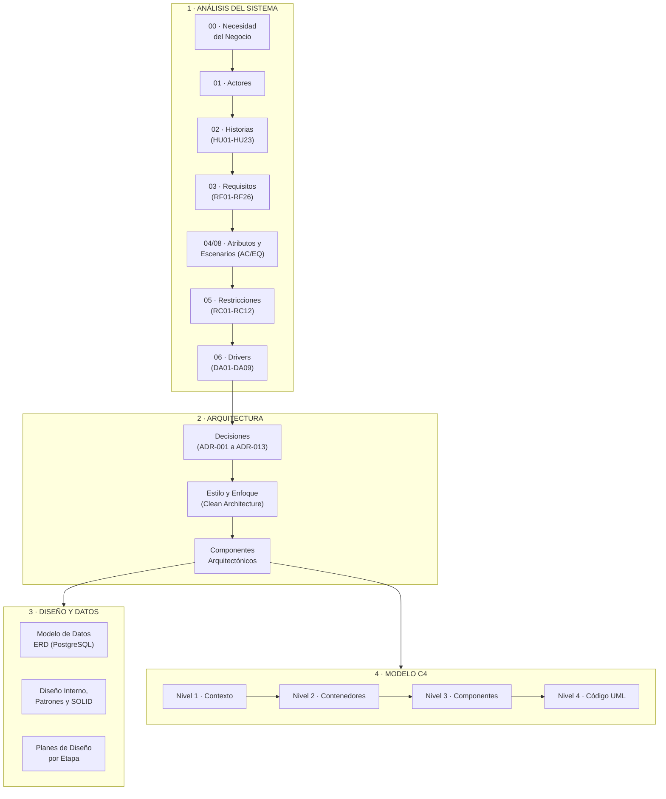

# Mapa Maestro de Documentación y Modelado · JAMA

> **Sistema:** Marketplace Web de Ofertas de Cierre (JAMA)  
> **Arquitectura:** Monolito Modular + Clean Architecture · **Base de Datos:** PostgreSQL (Supabase) · **Frontend:** SPA React + Vite  
> **Estado actual:** Desplegado en producción ([`jama-web.vercel.app`](https://jama-web.vercel.app/)) · Flujo Concierge Yape activo · **128 pruebas unitarias** pasando.

---

## Mapa de Flujo Arquitectónico y Trazabilidad

---

## 1 · Análisis de Sistema ([`01-analisis-de-sistema/`](01-analisis-de-sistema/))

| Documento | Contenido principal |
|---|---|
| [`00-necesidad-del-negocio.md`](01-analisis-de-sistema/00-necesidad-del-negocio.md) | Problema de mermas en Huamanga, objetivos del negocio (`ON01–ON06`) y alcance del MVP Concierge. |
| [`01-actores.md`](01-analisis-de-sistema/01-actores.md) | Actores humanos (Cliente, Negocio, Operador/Admin JAMA) y sistemas externos (WhatsApp, Maps, Supabase Storage, Yape/Plin). |
| [`02-historias-del-usuario.md`](01-analisis-de-sistema/02-historias-del-usuario.md) | **23 Historias de Usuario (`HU01–HU23`)** agrupadas por actor (`Cliente`, `Negocio`, `Administrador`). |
| [`03-requisitos-funcionales.md`](01-analisis-de-sistema/03-requisitos-funcionales.md) | **26 Requisitos Funcionales (`RF01–RF26`)** agrupados por dominio (Bloques A–E), con estado real y matriz de trazabilidad `HU ⇄ RF`. |
| [`04-atributos-de-calidad.md`](01-analisis-de-sistema/04-atributos-de-calidad.md) | Atributos no funcionales (`AC01–AC09`: rendimiento móvil, consistencia sin sobreventas, seguridad, trazabilidad). |
| [`05-restricciones.md`](01-analisis-de-sistema/05-restricciones.md) | Restricciones tecnológicas, operativas y legales (`RC01–RC12`), incluyendo modelo Concierge Yape y Ley 30498. |
| [`06-driver-arquitectonicos.md`](01-analisis-de-sistema/06-driver-arquitectonicos.md) | Drivers arquitectónicos priorizados (`DA01–DA09`) y su decisión asociada. |
| [`07-decisiones-arquitectonicas.md`](01-analisis-de-sistema/07-decisiones-arquitectonicas.md) | Tabla resumen de los **13 ADRs** vinculados a los drivers. |
| [`08-escenarios-atributos-calidad.md`](01-analisis-de-sistema/08-escenarios-atributos-calidad.md) | Escenarios medibles y verificables (`EQ-01` a `EQ-09`) para validar calidad en pruebas y piloto. |

---

## 2 · Arquitectura de Software ([`02-arquitectura-software/`](02-arquitectura-software/))

| Documento | Contenido principal |
|---|---|
| [`arquitectura-inicial.md`](02-arquitectura-software/arquitectura-inicial.md) | Visión de 3 capas, flujo crítico de pedido Concierge y máquina de estados del código de canje. |
| [`estilo-arquitectonico.md`](02-arquitectura-software/estilo-arquitectonico.md) | Justificación del estilo **Monolito Modular** cliente-servidor frente a alternativas descartadas. |
| [`enfoque-arquitectonico.md`](02-arquitectura-software/enfoque-arquitectonico.md) | Organización interna con **Clean Architecture** (Dominio, Aplicación, Infraestructura, Presentación) y regla de dependencias. |
| [`componentes-arquitectonicos.md`](02-arquitectura-software/componentes-arquitectonicos.md) | Mapa de módulos del backend (`Acceso`, `Negocios`, `Ofertas`, `Pedidos`), responsabilidades y matriz de trazabilidad completa. |
| [`decisiones/README.md`](02-arquitectura-software/decisiones/README.md) | Índice de **13 Architecture Decision Records (`ADR-001` a `ADR-013`)** que documentan cada decisión clave del sistema. |

---

## 3 · Diseño de Software y Modelo de Datos ([`03-diseno-de-software/`](03-diseno-de-software/))

| Documento | Contenido principal |
|---|---|
| [`modelo-datos-erd.md`](03-diseno-de-software/modelo-datos-erd.md) | **Diagrama Entidad-Relación (ERD)** oficial de PostgreSQL (`negocios`, `ofertas`, `codigos_canje`, `administradores`) y migraciones `001–006`. |
| [`diseno-interno/diseno-interno-de-modulos.md`](03-diseno-de-software/diseno-interno/diseno-interno-de-modulos.md) | Reglas de negocio (`RN-01` a `RN-18`), estructura de carpetas y diagrama de clases de los módulos. |
| [`diseno-interno/patrones-de-diseno.md`](03-diseno-de-software/diseno-interno/patrones-de-diseno.md) | Catálogo de patrones aplicados: Repository, Adapter, Unit of Work, State Machine, Facade, Composition Root. |
| [`diseno-interno/principios-de-diseno.md`](03-diseno-de-software/diseno-interno/principios-de-diseno.md) | Evidencia práctica de principios **SOLID** en el código real del módulo `Pedidos`. |
| **Planes de Diseño Ejecutados** | Especificaciones detalladas por etapa: [Alta de negocios](03-diseno-de-software/plan-alta-de-negocios.md) · [Categorías y Otros](03-diseno-de-software/plan-gestion-categorias-y-otros.md) · [Filtros vitrina](03-diseno-de-software/plan-filtros-categoria-vitrina.md) · [Edición/Republicación](03-diseno-de-software/plan-edicion-y-republicacion-ofertas.md) · [Perfiles y Portada](03-diseno-de-software/plan-perfil-negocio-portada.md) · [Redes y Kit QR](03-diseno-de-software/plan-redes-sociales-y-qr-mostrador.md) · [Métricas de Impacto](03-diseno-de-software/plan-metricas-impacto-comercial.md) · [Flujo Concierge Yape](03-diseno-de-software/plan-flujo-concierge-cobro-yape-y-publicacion-asistida.md). |

---

## 4 · Modelo C4 ([`04-modelo-c4/`](04-modelo-c4/))

| Nivel | Documento | Alcance visual |
|---|---|---|
| **Nivel 1 · Contexto** | [`Nivel1-DiagramadeContextodelSistema.md`](04-modelo-c4/Nivel1-DiagramadeContextodelSistema.md) | Marketplace JAMA como sistema central frente a Cliente, Negocio, Admin, Yape, WhatsApp, Storage y Google Maps. |
| **Nivel 2 · Contenedores** | [`Nivel2-DiagramadeContenedores.md`](04-modelo-c4/Nivel2-DiagramadeContenedores.md) | SPA React/Vite (`web/`), API REST Node.js/Express (`api/`), PostgreSQL (Supabase) y Supabase Storage. |
| **Nivel 3 · Componentes** | [`Nivel3-Diagrama-de-Componentes.md`](04-modelo-c4/Nivel3-Diagrama-de-Componentes.md) | Desglose interno de la API: rutas `/api/v1`, los 4 módulos reales (`Acceso`, `Negocios`, `Ofertas`, `Pedidos`) y la tarea programada. |
| **Nivel 4 · Código** | [`Nivel4-DiagramadeCodigo.md`](04-modelo-c4/Nivel4-DiagramadeCodigo.md) | Diagrama de clases UML (`Pedidos ↔ Ofertas`), máquina de estados de `CodigoCanje`, y secuencias de resolución (Negocio/Admin Concierge) y expiración. |

> **Recursos gráficos exportados ([`img/`](img/)):** Contiene versiones PNG de los diagramas para su inserción en documentos académicos y presentaciones.
